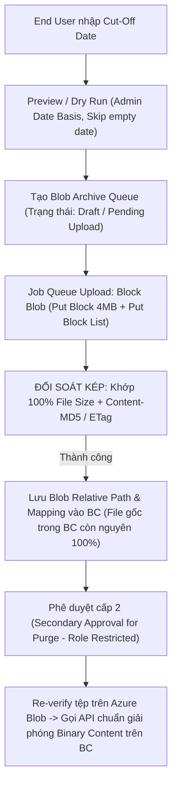

# Business Central File Archiving to Azure Blob Storage

> **AL Extension độc lập dành cho Microsoft Dynamics 365 Business Central (Cloud SaaS v28)**  
> Giải pháp di dời và lưu trữ tệp đính kèm sang **Azure Blob Storage (ABS)** nhằm giải phóng triệt để dung lượng cơ sở dữ liệu, tối ưu chi phí lưu trữ (>95–99.5%), loại bỏ giới hạn quota và duy trì khả năng mở tệp trực tiếp từ BC.  
> *(Ghi chú kiến trúc: Toàn bộ thiết kế kỹ thuật của phương án SharePoint Online trước đó vẫn được lưu giữ đầy đủ để tham chiếu).*

---

## 📌 1. Mục tiêu Dự án (Objective) & Quyết định Chuyển đổi Nền tảng

Hệ thống Business Central hiện đang sử dụng **218.45 GB / 110 GB** dung lượng cấp phát (vượt quá 198%), trong đó:
* **Tenant Media:** Chiếm ~**83.4 GB** (191,199 records).
* **Incoming Document Attachments:** Chiếm ~**8 GB** (~38,200 records giữa APSS-SG và Test SG08).

### Quyết định Lựa chọn Nền tảng Lưu trữ (Azure Blob Storage)
Sau khi đánh giá toàn diện bài toán kinh tế và hạn mức kỹ thuật (Quota):
1. **Chi phí:** Giá mua thêm dung lượng SharePoint Online rất cao (~**\$0.20 / GB / tháng** $\rightarrow$ \$200/TB/tháng). Trong khi đó, **Azure Blob Storage Cool Tier** chỉ ~**\$0.010 / GB / tháng** và **Archive Tier** chỉ ~**\$0.00099 / GB / tháng** (tiết kiệm hơn **96% - 99.5%** chi phí dài hạn).
2. **Hạn mức & Băng thông:** SharePoint giới hạn 1 TB + 10 GB/user và ngưỡng 5,000 items/view, đồng thời Graph API dễ bị bóp băng thông (HTTP 429 Throttling) khi chạy Job Queue ban đêm. Azure Blob Storage hỗ trợ tới **5 Petabytes** và băng thông lên đến 60 Gbps.
3. **Tích hợp Native:** Business Central v28 tích hợp sẵn module chuẩn **`Azure Blob Storage Services API`** (System Application), giúp kết nối ổn định, trực tiếp và bảo mật cao mà không phụ thuộc thư viện ngoài.

---

## 🛡️ 2. Giới hạn đỏ & Nguyên tắc An toàn (Safety Guardrails)

* **TUYỆT ĐỐI KHÔNG can thiệp trực tiếp vào `Tenant Media` hay dùng Direct SQL:**
  * Việc xóa trực tiếp `Tenant Media` sẽ phá vỡ cơ chế đếm tham chiếu (Reference Counting) của BC và gây lỗi gãy liên kết (Broken Reference) trên các chứng từ dùng chung Media (ví dụ khi post Sales Order $\rightarrow$ Posted Sales Invoice).
  * Việc xóa nội dung phải thông qua record và API chuẩn của BC (`Clear(Document Reference ID)` trên Table 1173 hoặc `Clear(Content)` của Table 133 kết hợp `Modify(false)`).
* **Phạm vi nghiêm cấm can thiệp (Strict Exclusions):**
  * `Sales Header Archive` / `Sales Line Archive` (Table 5107, 5108)
  * `Purchase Header Archive` / `Purchase Line Archive` (Table 5109, 5110)
  * Dữ liệu APSS SQ-to-PQ archive
  * Toàn bộ sổ cái và chứng từ giao dịch/kế toán (`G/L Entry`, `Cust. Ledger Entry`, v.v.)
  * System Media và Application Media
* **Độc lập và an toàn:**
  * Đóng gói thành **AL Extension độc lập**, không sửa đổi mã nguồn Production của APSS.
  * Tách rời **2 pha: Upload vs. Purge**. Bắt buộc có phê duyệt lần 2 (Secondary Approval) trước khi giải phóng nội dung nhị phân trên BC.
* **KHÓA CỨNG TÍNH NĂNG PURGE (HARD-LOCK GATEKEEPER):** Toàn bộ chức năng Purge tiếp tục bị khóa cứng trên cả giao diện và codeunit cho đến khi vượt qua các chốt chặn kiểm nghiệm thực tế trên Sandbox.
* **Nguyên tắc Quản trị WORM (Immutability Policy):**
  * Chính sách WORM trên Azure Blob Storage bắt buộc phải để **Configurable**.
  * **PoC chỉ sử dụng Unlocked policy**, tuyệt đối CHƯA LOCK trên Production cho đến khi Finance/Legal chính thức phê duyệt thời hạn lưu trữ (retention period), date basis và quy trình xử lý file upload nhầm / duplicate.

---

## 🏗️ 3. Kiến trúc & Quy trình Vận hành

### 3.1. Cấu trúc Đường dẫn Azure Blob (Virtual Hierarchy)
$$\mathbf{\text{[Container Name]}} \;/\; \mathbf{\text{[Base Folder Path]}} \;/\; \mathbf{\text{[Company Name]}} \;/\; \mathbf{\text{[Document Type]}} \;/\; \mathbf{\text{[Document No.]}} \;/\; \mathbf{\text{[File Name]}}$$
* *Chống trùng lặp:* Cấp mã băm `Deterministic Archive Key` (SHA-256) cho từng bản ghi hàng đợi.
* *Làm sạch đường dẫn (Sanitization):* Loại bỏ ký tự cấm, khử chuỗi `../` (Path Traversal), khống chế URL $\le 1024$ ký tự.

### 3.2. Quy tắc Cut-Off Date & Đánh giá Ngày Chứng từ (Strict Audit & No-Fallback)
* **Phân định thẩm quyền:**
  * **Admin:** Cấu hình quy tắc ngày (`Date Basis`: Posting Date vs Document Date) cố định theo từng `Document Type` trong Setup.
  * **End-user:** Chỉ nhập duy nhất mốc ngày **`Cut-off Date`** (không tự ý chọn field ngày để đảm bảo tính nhất quán và kiểm toán).
* **Quy tắc Strict No-Fallback:** Nếu chứng từ bị trống ngày quy định $\rightarrow$ **Skip ngay lập tức, ghi log warning**, tuyệt đối không tự ý fallback sang trường ngày khác (như Attached Date).
* **Minh bạch kiểm toán:** Màn hình Preview và Audit Log lưu vết rõ ràng `Evaluated Date Field` và `Evaluated Date Value`.

### 3.3. Quy trình Xử lý Bất đồng bộ 2 Pha


### 3.4. Bảo mật & Truy cập Tệp (Private Container & Short-Lived SAS Token)
* Container Azure Blob được đóng kín hoàn toàn ở chế độ **Private (No anonymous public access)**.
* Khi người dùng click `Open from Azure Blob` trên chứng từ BC, hệ thống tự động sinh **Short-Lived Read-only SAS URL (thời hạn 15–30 phút)** rồi mở trên trình duyệt. Hết hạn, link tự hủy, chống hoàn toàn nguy cơ lộ lọt tài liệu ra ngoài.

---

## 📁 4. Cấu trúc Thư mục Dự án

```text
BC File Archiving to SharePoint / Azure Blob/
├── .alpackages/               # Các gói symbol chuẩn của Microsoft (Base App, System App v28)
├── .vscode/
│   ├── extensions.json        # Khuyến nghị extension AL Language
│   ├── launch.json            # Cấu hình Sandbox Cloud (startupObjectId: 50140)
│   └── settings.json          # Thiết lập CodeCop & PerTenantExtensionCop
├── docs/
│   ├── TECHNICAL_DESIGN_AZURE_BLOB.md          # [CHÍNH] Thiết kế Kỹ thuật & Data Model Azure Blob Storage
│   ├── STORAGE_COMPARISON_SHAREPOINT_VS_AZURE_BLOB.md # So sánh toàn diện TCO, Quota, Security, Hybrid Architecture
│   ├── TECHNICAL_DESIGN_AND_DATA_MODEL.md      # [THAM CHIẾU] Thiết kế Kỹ thuật SharePoint Online
│   ├── USER_AND_ADMIN_GUIDE.md                 # Hướng dẫn Vận hành & Từ điển Dữ liệu (User & Admin Guide)
│   └── TEST_EXECUTION_REPORT.md                # Báo cáo Thực thi Kiểm thử (TC-01 Dry-Run 175 tệp PASSED)
├── src/
│   ├── Codeunit/              # Logic Dry-Run Scanner, Graph Client, ABS Native Client, Purge Mgt.
│   ├── Enum/                  # Trạng thái Archive Process, Purge Process, và Audit Action
│   ├── Page/                  # Giao diện Setup, Queue, Audit Log
│   ├── PageExtension/         # Mở rộng hiển thị link lưu trữ trên Page 1173, 193, 194
│   ├── PermissionSet/         # Phân quyền SPArchivePermSet
│   └── Table/                 # Bảng Setup, Queue Entry, Audit Log, Link Mapping (ID 50140..50189)
├── app.json                   # Cấu hình AL extension (ID Range: 50140..50189, Platform/App: 28.0)
└── README.md                  # Hướng dẫn tổng quan dự án
```

---

## 📖 5. Hệ Thống Tài Liệu Kỹ Thuật

| Tài liệu | Mô tả | Liên kết |
| :--- | :--- | :---: |
| **Thiết Kế Kỹ Thuật Azure Blob** | Đặc tả AL Data Model, Azure Blob REST API, Block Blob, SAS, WORM Policy | [Xem tài liệu](docs/TECHNICAL_DESIGN_AZURE_BLOB.md) |
| **So Sánh SharePoint vs. Azure Blob** | Phân tích TCO chi phí 5 năm, giới hạn Quota, hiệu năng, mô hình Hybrid | [Xem tài liệu](docs/STORAGE_COMPARISON_SHAREPOINT_VS_AZURE_BLOB.md) |
| **Thiết Kế Kỹ Thuật SharePoint** | Đặc tả kỹ thuật phương án SharePoint Online (M365 Graph API) | [Xem tài liệu](docs/TECHNICAL_DESIGN_AND_DATA_MODEL.md) |
| **Hướng Dẫn Quản Trị & Vận Hành** | Giải thích chi tiết toàn bộ field, nút chức năng và từ điển dữ liệu | [Xem tài liệu](docs/USER_AND_ADMIN_GUIDE.md) |
| **Báo Cáo Kiểm Thử (Test Report)** | Ghi nhận kết quả thực thi kiểm nghiệm thực tế (TC-01 Dry-Run) | [Xem tài liệu](docs/TEST_EXECUTION_REPORT.md) |
