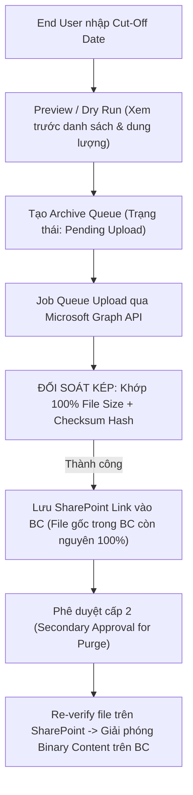

# Business Central File Archiving to SharePoint

> **AL Extension độc lập dành cho Microsoft Dynamics 365 Business Central (Cloud SaaS)**  
> Giải pháp di dời và lưu trữ tệp đính kèm cũ sang Microsoft SharePoint Online nhằm giảm dung lượng cơ sở dữ liệu, duy trì khả năng truy vết và mở tệp trực tiếp từ BC.

---

## 📌 1. Mục tiêu Dự án (Objective)

Hệ thống Business Central hiện đang sử dụng **218.45 GB / 110 GB** dung lượng cấp phát (vượt quá 198%), trong đó:
* **Tenant Media:** Chiếm ~**83.4 GB** (191,199 records).
* **Incoming Document Attachments:** Chiếm ~**8 GB** (~38,200 records giữa APSS-SG và Test SG08).

**Mục tiêu chính:**
1. Di dời nội dung nhị phân (binary content) của các tệp đính kèm cũ hơn ngày cut-off do người dùng nhập sang SharePoint Online.
2. Lưu giữ liên kết SharePoint (SharePoint URL) và lịch sử kiểm toán trong BC để người dùng vẫn mở và tra cứu tệp bình thường.
3. Giải phóng an toàn dung lượng lưu trữ của BC mà không làm đứt gãy tham chiếu hoặc ảnh hưởng đến chứng từ kế toán.

---

## 🛡️ 2. Giới hạn đỏ & Nguyên tắc An toàn (Safety Guardrails)

* **TUYỆT ĐỐI KHÔNG can thiệp trực tiếp vào `Tenant Media` hay dùng Direct SQL:**
  * Việc xóa trực tiếp `Tenant Media` sẽ phá vỡ cơ chế đếm tham chiếu (Reference Counting) của BC và gây lỗi gãy liên kết (Broken Reference) trên các chứng từ dùng chung Media (ví dụ khi post Sales Order $\rightarrow$ Posted Sales Invoice).
  * Việc xóa nội dung phải thông qua record và API chuẩn của BC (`Remove()` trên trường `Media` của Table 1173 hoặc `Clear(Content)` của Table 133).
* **Phạm vi nghiêm cấm can thiệp (Strict Exclusions):**
  * `Sales Header Archive` / `Sales Line Archive` (Table 5107, 5108)
  * `Purchase Header Archive` / `Purchase Line Archive` (Table 5109, 5110)
  * Dữ liệu APSS SQ-to-PQ archive
  * Toàn bộ sổ cái và chứng từ giao dịch/kế toán (`G/L Entry`, `Cust. Ledger Entry`, v.v.)
  * System Media và Application Media
* **Độc lập và an toàn:**
  * Đóng gói thành **AL Extension độc lập**, không sửa đổi mã nguồn Production của APSS.
  * Tách rời **2 pha: Upload vs. Purge**. Bắt buộc có phê duyệt lần 2 (Secondary Approval) trước khi giải phóng nội dung nhị phân trên BC.

---

## 🏗️ 3. Kiến trúc & Quy trình 2 Pha

### 3.1. Cấu trúc thư mục SharePoint
$$\mathbf{\text{[SharePoint Library]}} \;/\; \mathbf{\text{[Company Name]}} \;/\; \mathbf{\text{[Document Type]}} \;/\; \mathbf{\text{[Document No.]}} \;/\; \mathbf{\text{[File Name]}}$$
* *Chống trùng lặp:* Tự động gán hậu tố `_[LineNo]` hoặc `_[SystemId_Short]` nếu một chứng từ có nhiều file cùng tên.
* *Làm sạch đường dẫn (Sanitization):* Loại bỏ ký tự cấm của SharePoint (`~ " # % & * : < > ? / \ { | }`), xử lý dấu chấm và khoảng trắng cuối tên, đảm bảo URL $\le 400$ ký tự.

### 3.2. Quy trình xử lý


### 3.3. Bảo mật theo Đặc quyền Tối thiểu (Least Privilege)
* Không dùng quyền diện rộng `Files.ReadWrite.All`.
* Ứng dụng Entra ID sử dụng quyền Application **`Sites.Selected`** và chỉ được cấp quyền ghi (`write`) trên đúng 1 SharePoint Site Collection chỉ định làm Archive.
* Toàn bộ Secret/Certificate được bảo mật bằng **`IsolatedStorage`** của AL, tuyệt đối không lưu plain text trong table.

---

## 📁 4. Cấu trúc Thư mục Dự án

```text
BC File Archiving to SharePoint/
├── .alpackages/               # Các gói symbol chuẩn của Microsoft (Base App, System App)
├── .vscode/
│   ├── extensions.json        # Khuyến nghị extension AL Language
│   ├── launch.json            # Cấu hình kết nối Sandbox Cloud
│   └── settings.json          # Thiết lập CodeCop & PerTenantExtensionCop
├── docs/
│   └── TECHNICAL_DESIGN_AND_DATA_MODEL.md  # Tài liệu Thiết kế Kỹ thuật & Data Model chi tiết
├── src/
│   ├── Codeunit/              # Logic OAuth2, Microsoft Graph API, Chunked Upload, Purge Mgt.
│   ├── Enum/                  # Trạng thái Archive, Purge, và loại Audit Log
│   ├── Page/                  # Giao diện Setup, Queue, Preview, Audit Log
│   ├── PageExtension/         # Mở rộng hiển thị link SharePoint trên các Page chuẩn
│   ├── PermissionSet/         # Phân quyền SPArchivePermSet
│   ├── Report/                # Báo cáo thống kê dung lượng giải phóng
│   ├── Table/                 # Bảng Setup (50100), Queue (50101), Audit Log (50102), Link Mapping (50103)
│   └── TableExtension/        # Bổ sung trường kiểm soát an toàn (nếu cần)
├── app.json                   # Cấu hình AL extension (ID Range: 50100..50149, Platform/App: 28.0)
└── README.md                  # Hướng dẫn tổng quan dự án
```

---

## 📊 5. Danh mục Hạng mục Công việc (Jira Work Items)

| Mã Task | Tên Task | Mức ưu tiên | Trọng tâm công việc |
| :--- | :--- | :---: | :--- |
| **KAN-35** | *Measure storage and attachment inventory* | Medium | Thống kê chi tiết số lượng, phân bổ tuổi file và dung lượng có thể thu hồi. |
| **KAN-31** | *Confirm retention scope and cutoff* | Medium | Chốt quy tắc so khớp ngày cut-off (`Posting Date` vs `Attached Date`). |
| **KAN-30** | *Design authentication and security* | **High** | Thiết kế Entra ID App, quyền `Sites.Selected`, quản lý credentials qua IsolatedStorage. |
| **KAN-36** | *Design SharePoint archive structure* | Medium | Chuẩn hóa cấu trúc thư mục, quy tắc sanitize và cơ chế chống trùng file. |
| **KAN-33** | *Build BC archive setup and migration log* | Medium | Hiện thực 4 bảng: Archive Setup, Queue Entry, Audit Log, Link Mapping. |
| **KAN-34** | *Implement upload and verification pipeline* | Medium | Xây dựng pipeline tải tệp (Chunked upload >4MB), đối soát size/hash, xử lý retry HTTP 429. |
| **KAN-29** | *Implement safe retention and purge controls* | Medium | Thiết lập cơ chế kiểm soát phê duyệt lần 2 và gọi API chuẩn giải phóng dung lượng. |
| **KAN-32** | *Test, deploy and document operations* | Medium | Bộ 8 Test Cases trên Sandbox copy, tài liệu triển khai, vận hành và khôi phục thảm họa. |

---

## 📖 6. Tài liệu Kỹ thuật Chi tiết
Toàn bộ đặc tả mô hình dữ liệu (AL Tables, Enums), quy trình đối soát kép, xử lý Throttling HTTP 429 và Test Plan chi tiết được lưu trữ tại:  
👉 **[`docs/TECHNICAL_DESIGN_AND_DATA_MODEL.md`](docs/TECHNICAL_DESIGN_AND_DATA_MODEL.md)**
