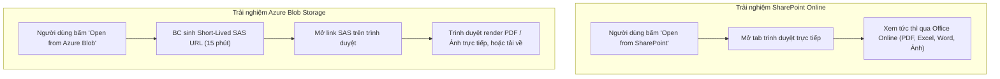
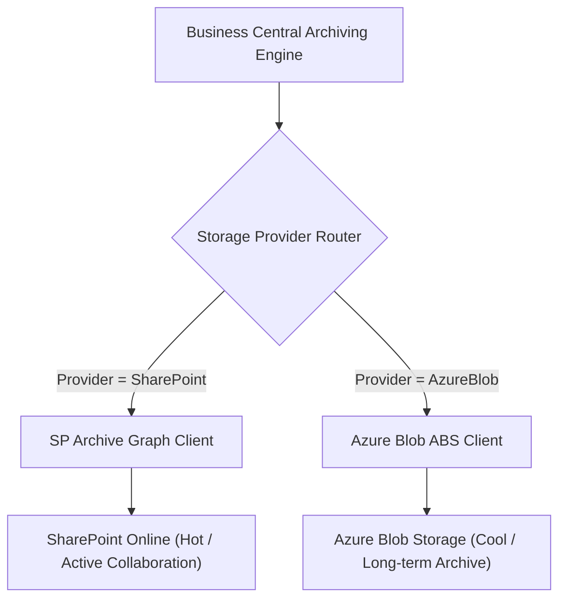
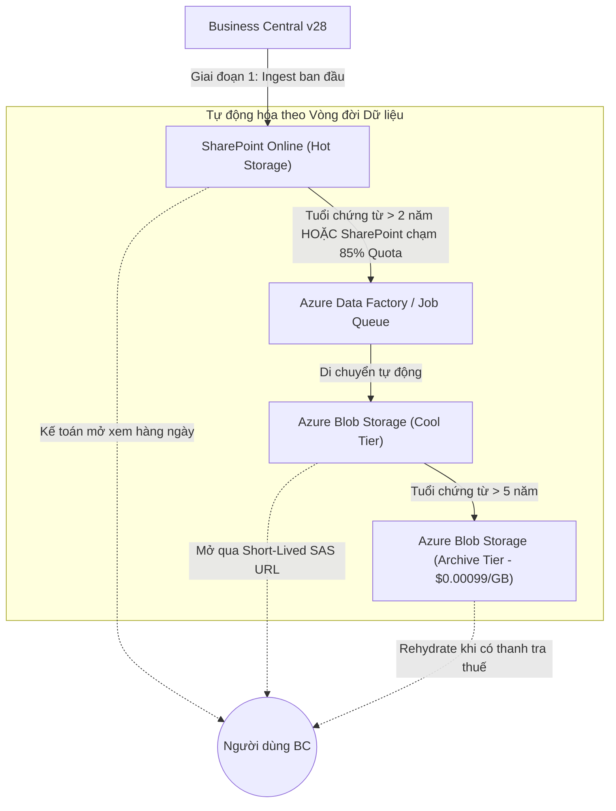

# SO SÁNH TOÀN DIỆN GIẢI PHÁP LƯU TRỮ: SHAREPOINT ONLINE VS. AZURE BLOB STORAGE
## (HỆ THỐNG BUSINESS CENTRAL FILE ARCHIVING)

- **Hệ thống:** Dynamics 365 Business Central Cloud v28 (SaaS)
- **Tài liệu tham chiếu:** `TECHNICAL_DESIGN_AND_DATA_MODEL.md` (SharePoint) & `TECHNICAL_DESIGN_AZURE_BLOB.md` (Azure Blob)
- **Mục tiêu:** Cung cấp góc nhìn phân tích đa chiều về kỹ thuật, chi phí, bảo mật, hiệu năng và định hướng kiến trúc mở rộng dài hạn cho doanh nghiệp.

---

## MỤC LỤC
1. [Bảng So Sánh Tổng Hợp Đa Chiều (Core Matrix)](#1-bảng-so-sánh-tổng-hợp-đa-chiều-core-matrix)
2. [Phân Tích Chi Tiết Từng Khía Cạnh](#2-phân-tích-chi-tiết-từng-khía-cạnh)
   - 2.1. [Bài toán Kinh tế & Chi phí Sở hữu (TCO Analysis)](#21-bài-toán-kinh-tế--chi-phí-sở-hữu-tco-analysis)
   - 2.2. [Hiệu Năng API, Tải Băng Thông & Giới Hạn Throttling](#22-hiệu-năng-api-tải-băng-thông--giới-hạn-throttling)
   - 2.3. [Bảo Mật, Phân Quyền & Kiểm Soát Rò Rỉ Dữ Liệu](#23-bảo-mật-phân-quyền--kiểm-soát-rò-rỉ-dữ-liệu)
   - 2.4. [Trải Nghiệm Người Dùng & Khả Năng Xem Trực Tiếp](#24-trải-nghiệm-người-dùng--khả-năng-xem-trực-tiếp)
   - 2.5. [Tuân Thủ Pháp Lý, Chống Giả Mạo & Vòng Đời Dữ Liệu](#25-tuân-thủ-pháp-lý-chống-giả-mạo--vòng-đời-dữ-liệu)
3. [Đánh Giá Khả Năng Mở Rộng & Định Hướng Phát Triển Tương Lai](#3-đánh-giá-khả-năng-mở-rộng--định-hướng-phát-triển-tương-lai)
   - 3.1. [Khả năng Phục hồi Thảm họa & Dự phòng Địa lý (Disaster Recovery & Geo-Redundancy)](#31-khả-năng-phục-hồi-thảm-họa--dự-phòng-địa-lý-disaster-recovery--geo-redundancy)
   - 3.2. [Kiến trúc Cổng Lưu trữ Đa Đích (Multi-Target Storage Gateway)](#32-kiến-trúc-cổng-lưu-trữ-đa-đích-multi-target-storage-gateway)
4. [Ma Trận Ra Quyết Định (Decision Framework)](#4-ma-trận-ra-quyết-định-decision-framework)
5. [Khuyến Nghị Kiến Trúc Tối Ưu: Mô Hình Phân Tầng Kết Hợp (Hybrid Model)](#5-khuyến-nghị-kiến-trúc-tối-ưu-mô-hình-phân-tầng-kết-hợp-hybrid-model)

---

## 1. BẢNG SO SÁNH TỔNG HỢP ĐA CHIỀU (CORE MATRIX)

| Tiêu chí So sánh | Microsoft SharePoint Online | Azure Blob Storage (ABS) | Đánh giá / Khuyến nghị |
| :--- | :--- | :--- | :--- |
| **Bản chất dịch vụ** | Nền tảng làm việc cộng tác, quản trị nội dung (CMS) và chia sẻ tệp doanh nghiệp. | Dịch vụ hạ tầng đám mây (IaaS/PaaS) lưu trữ đối tượng nhị phân khối lớn thuần túy. | SharePoint hướng tới **người dùng**, Azure Blob hướng tới **hạ tầng & máy móc**. |
| **Đơn vị lưu trữ cơ sở** | Site Collection $\rightarrow$ Document Library $\rightarrow$ Folder $\rightarrow$ File. | Storage Account $\rightarrow$ Container $\rightarrow$ Virtual Directory $\rightarrow$ Block Blob. | Azure Blob phẳng và linh hoạt hơn, không bị ràng buộc bởi cấu trúc Site. |
| **Chi phí lưu trữ (Storage Cost)** | **Rất đắt:** Mua thêm dung lượng vượt gói ~**\$0.20 / GB / tháng** (\$200/TB/tháng). | **Cực rẻ:**<br>- *Hot:* ~\$0.018 / GB / tháng<br>- *Cool:* ~**\$0.010 / GB / tháng**<br>- *Archive:* ~**\$0.00099 / GB / tháng** (\$1/TB/tháng). | Azure Blob rẻ hơn **từ 20 đến 200 lần** so với SharePoint Online. |
| **Giới hạn dung lượng (Quota Limits)** | Mặc định: `1 TB + (10 GB x số User M365)`. Tối đa 25 TB mỗi Site Collection. | Tối đa **5 Petabytes (5,000 TB)** mỗi Storage Account. Hầu như không có giới hạn vật lý thực tế. | Azure Blob vượt trội hoàn toàn về khả năng mở rộng không gian lưu trữ dài hạn. |
| **Trải nghiệm xem tệp (Viewing UX)** | **Xuất sắc:** Mở xem trực tiếp cực mượt trên trình duyệt (Word, Excel, PDF, hình ảnh) qua Office Online. | Cần cơ chế sinh **Temporary Read-only SAS URL** hoặc tải tệp về trình duyệt để xem. | SharePoint mang lại trải nghiệm tiện lợi tự nhiên nhất cho nhân viên kế toán. |
| **Giới hạn View / Truy vấn** | Giới hạn **5,000 items/view** (List View Threshold) đòi hỏi cấu hình index phức tạp. | Không giới hạn số lượng Blob trong 1 Container (hỗ trợ hàng trăm triệu tệp). | Azure Blob không lo nghẽn danh sách tệp khi lưu trữ quy mô lớn qua nhiều năm. |
| **Tốc độ Upload & Băng thông** | Phụ thuộc Microsoft Graph API và giới hạn băng thông tenant M365. | Băng thông cực lớn (lên tới 60 Gbps egress / ingress cho mỗi Storage Account). | Azure Blob xử lý tải hàng loạt (Batch Processing) nhanh và ổn định hơn. |
| **Rủi ro Throttling (Nghẽn mạng)** | **Cao:** Graph API áp dụng cơ chế đánh tụt băng thông gắt gao (HTTP 429 Too Many Requests). | **Rất thấp:** Khả năng chịu tải cực cao, chỉ gặp HTTP 503 khi chạm ngưỡng IOPS hàng chục ngàn req/s. | Azure Blob an toàn hơn khi chạy Job Queue upload hàng chục nghìn tệp liên tục ban đêm. |
| **Phương thức Xác thực** | Microsoft Entra ID App Registration (OAuth2 Client Credentials) với quyền `Sites.Selected`. | Hỗ trợ đa dạng: **SAS Token**, **Entra ID RBAC** (`Storage Blob Data Contributor`), **Shared Key**. | Azure Blob có tùy chọn SAS Token phân quyền chi tiết đến từng Container/Blob cụ thể. |
| **Bảo mật & Rò rỉ Link** | Link Web SharePoint phụ thuộc phân quyền nội bộ M365 của người dùng. | Container Private 100%. Sinh link **SAS Token tạm thời có hạn giờ (15-30 phút)** rồi tự hủy. | Azure Blob hạn chế tối đa nguy cơ nhân viên copy link gửi ra ngoài công ty. |
| **Chính sách Vòng đời (Lifecycle)** | Cấu hình Retention Policy và Versioning trên M365 Compliance Center. | **Tự động hóa hoàn toàn:** Lifecycle Management Rules tự chuyển từ Hot $\rightarrow$ Cool $\rightarrow$ Archive. | Azure Blob tối ưu chi phí tự động theo tuổi thọ chứng từ mà không cần người can thiệp. |
| **Tính bất biến (Immutability / WORM)** | M365 Retention Lock (cấu hình phức tạp trên tenant level). | **Immutable Storage (WORM):** Time-based retention policy khóa cứng chống xóa/sửa cấp Container. | Cả hai đều đáp ứng chuẩn kiểm toán thuế, Azure Blob dễ quản trị độc lập hơn. |

---

## 2. PHÂN TÍCH CHI TIẾT TỪNG KHÍA CẠNH

### 2.1. Bài toán Kinh tế & Chi phí Sở hữu (TCO Analysis)

Xét bài toán doanh nghiệp tích lũy dữ liệu chứng từ đính kèm (hóa đơn, biên bản giao hàng, hợp đồng, chứng từ ngân hàng) với tốc độ tăng trưởng **500 GB mỗi năm**:

```
+------------------------------------------------------------------------------------------+
|                        SO SÁNH CHI PHÍ LƯU TRỮ TÍCH LŨY THEO NĂM                         |
+---------------------+-------------------------------+------------------------------------+
|  Quy mô Dữ liệu     | SharePoint Online (Vượt Quota)| Azure Blob Storage (Cool + Archive)|
+---------------------+-------------------------------+------------------------------------+
| Năm 1 (500 GB)      | $100 / tháng  ($1,200 / năm)  | $5 / tháng     ($60 / năm)         |
| Năm 2 (1,000 GB)    | $200 / tháng  ($2,400 / năm)  | $10 / tháng    ($120 / năm)        |
| Năm 3 (1,500 GB)    | $300 / tháng  ($3,600 / năm)  | $12 / tháng *  ($144 / năm)        |
| Năm 5 (2,500 GB)    | $500 / tháng  ($6,000 / năm)  | $15 / tháng *  ($180 / năm)        |
+---------------------+-------------------------------+------------------------------------+
| TỔNG CHI PHÍ 5 NĂM  | ~$18,000 USD                  | ~$650 USD (Tiết kiệm > 96%)        |
+---------------------+-------------------------------+------------------------------------+
(*) Dữ liệu trên 2 năm tự động chuyển xuống Archive Tier ($0.00099/GB/tháng).
```

> [!TIP]
> **Nhận định kinh tế:** Nếu giữ toàn bộ hồ sơ lưu trữ trên SharePoint qua nhiều năm, chi phí phình to theo cấp số cộng. Azure Blob Storage giải quyết triệt để gánh nặng tài chính này cho doanh nghiệp.

---

### 2.2. Hiệu Năng API, Tải Băng Thông & Giới Hạn Throttling

1. **Microsoft Graph API (SharePoint):**
   - Thiết kế ưu tiên cho tương tác người dùng văn phòng.
   - Khi Business Central chạy Job Queue tải hàng loạt (hàng trăm tệp liên tục), Graph API rất dễ kích hoạt thuật toán **Throttling (HTTP 429)**. Hệ thống bắt buộc phải áp dụng Exponential Backoff để lùi tiến trình, làm kéo dài thời gian xử lý mẻ ban đêm.
2. **Azure Blob REST API / Block Blob:**
   - Được thiết kế chuyên biệt cho hệ thống dữ liệu lớn và truyền nhận máy-với-máy (Machine-to-Machine).
   - Cơ chế **`Put Block` + `Put Block List`** cho phép truyền song song các khối dữ liệu 4 MB với khả năng chịu lỗi cực cao.
   - Khả năng xử lý hàng chục nghìn request mỗi giây mà không bị đánh tụt băng thông.

---

### 2.3. Bảo Mật, Phân Quyền & Kiểm Soát Rò Rỉ Dữ Liệu

1. **Với SharePoint Online:**
   - Sử dụng cơ chế phân quyền kế thừa của M365 (Site Permissions / Library Permissions).
   - Rủi ro tiềm ẩn: Người dùng có thể vô tình tạo link chia sẻ ra ngoài (Share Link), hoặc một nhân viên bị thu hồi quyền trong BC nhưng vẫn còn tài khoản M365 thì vẫn có thể vào thẳng SharePoint tìm và đọc hóa đơn nếu không chặn quyền chặt chẽ.
2. **Với Azure Blob Storage:**
   - Container được đóng kín hoàn toàn ở chế độ **Private (No anonymous public access)**.
   - Người dùng thông thường **hoàn toàn không có tài khoản hay quyền truy cập trực tiếp** vào Azure Storage Account.
   - Quyền truy cập chỉ được cấp phát độc quyền thông qua Business Central: Khi kế toán cần xem, BC gọi hàm sinh **Short-lived SAS URL có thời hạn chỉ từ 15 đến 30 phút**. Sau khoảng thời gian này, đường link trở thành vô giá trị, triệt tiêu hoàn toàn rủi ro rò rỉ dữ liệu ra bên ngoài.

---

### 2.4. Trải Nghiệm Người Dùng & Khả Năng Xem Trực Tiếp



- **SharePoint vượt trội** về tính thân thiện: Xem trước văn phòng trực quan, hỗ trợ zoom, in ấn, tìm kiếm văn bản ngay trong trình duyệt.
- **Azure Blob Storage** vẫn hiển thị tốt trên trình duyệt với các định dạng chuẩn (PDF, JPG, PNG). Với các tệp đặc thù (Word, Excel), trình duyệt sẽ tải file về máy tính cá nhân trừ khi tích hợp thêm dịch vụ viewer trung gian.

---

### 2.5. Tuân Thủ Pháp Lý, Chống Giả Mạo & Vòng Đời Dữ Liệu

| Tiêu chuẩn Kế toán & Kiểm toán | SharePoint Online | Azure Blob Storage |
| :--- | :--- | :--- |
| **Chống xóa nhầm / Chống sửa (WORM)** | Hỗ trợ Retention Policy và Versioning trên Microsoft Purview. | Hỗ trợ **Immutable Storage (Time-Based Retention)**. *Lưu ý quan trọng:* Cần thiết kế **Configurable** (mặc định Unlocked trong PoC), chưa lock cứng trên Production cho đến khi Finance/Legal phê duyệt chính thức để tránh rủi ro không thể xóa file upload nhầm. |
| **Đối soát Toàn vẹn (Integrity Check)** | Sử dụng thuật toán băm riêng `quickXorHash` kết hợp File Size. | Sử dụng chuẩn quốc tế **`Content-MD5`** kết hợp **SHA-256 Checksum** và **Blob ETag**. |
| **Tự động chuyển tầng dữ liệu** | Không hỗ trợ tự động (dữ liệu nằm cố định một mức giá). | Tự động hoàn toàn qua **Lifecycle Management Rules** theo số ngày tuổi của tệp. |

---

## 3. ĐÁNH GIÁ KHẢ NĂNG MỞ RỘNG & ĐỊNH HƯỚNG PHÁT TRIỂN TƯƠNG LAI

### 3.1. Khả năng Phục hồi Thảm họa & Dự phòng Địa lý (Disaster Recovery & Geo-Redundancy)

- **SharePoint Online:** Doanh nghiệp phụ thuộc hoàn toàn vào hạ tầng mặc định của Microsoft 365 trong khu vực địa lý của tenant.
- **Azure Blob Storage:** Cung cấp các cấp độ dự phòng linh hoạt theo tiêu chuẩn khắt khe của ngân hàng/tài chính:
  - **LRS (Locally Redundant Storage):** Dự phòng 3 bản sao trong cùng 1 Data Center.
  - **ZRS (Zone-Redundant Storage):** Dự phòng đồng thời trên 3 Availability Zones khác nhau.
  - **GRS / GZRS (Geo-Redundant Storage):** Tự động sao lưu dữ liệu sang một vùng địa lý thứ hai cách xa hàng trăm km (chống thiên tai, sự cố hạ tầng diện rộng).

### 3.2. Kiến trúc Cổng Lưu trữ Đa Đích (Multi-Target Storage Gateway)

Cấu trúc mã nguồn hiện tại của dự án hoàn toàn cho phép mở rộng thành kiến trúc **Storage Gateway** linh hoạt bằng cách bổ sung trường `Storage Provider` vào `Archive Setup`:



---

## 4. MA TRẬN RA QUYẾT ĐỊNH (DECISION FRAMEWORK)

Doanh nghiệp nên lựa chọn nền tảng nào làm đích đến lưu trữ chính?

```
                     [BẮT ĐẦU ĐÁNH GIÁ NHU CẦU]
                                 │
                                 ▼
              Doanh nghiệp có nhu cầu nhân viên văn phòng
            mở xem, duyệt và chia sẻ file thường xuyên không?
                                 │
                  ┌──────────────┴──────────────┐
                 CÓ                             KHÔNG
                  │                               │
                  ▼                               ▼
       Dung lượng lưu trữ dự kiến       Dữ liệu thuần túy lưu trữ
         trong 1-2 năm là bao nhiêu?     kiểm toán thuế (WORM / Cold)?
                  │                               │
          ┌───────┴───────┐                       │
       < 1 TB          > 1 TB                     │
          │               │                       │
          ▼               ▼                       ▼
   [SHAREPOINT]     [MÔ HÌNH HYBRID]       [AZURE BLOB STORAGE]
```

### 1. Chọn **SharePoint Online** khi:
- Dữ liệu thuộc các năm tài chính gần nhất ($1\text{--}2$ năm).
- Nhân viên kế toán, mua hàng, bán hàng cần mở xem hóa đơn, chứng từ liên tục hàng ngày trên trình duyệt.
- Dung lượng tích lũy chưa chạm ngưỡng giới hạn Quota của tenant M365.

### 2. Chọn **Azure Blob Storage** khi:
- Dung lượng lưu trữ vượt quá $1\text{--}2\text{ TB}$, chi phí mua thêm SharePoint bắt đầu trở thành gánh nặng.
- Dữ liệu chứng từ cũ từ 2 đến 10 năm trước đã đóng sổ kế toán, mục đích chính là lưu trữ tĩnh phục vụ cơ quan thuế và kiểm toán độc lập.
- Yêu cầu kiểm soát an ninh tối đa: không cho phép chia sẻ link bừa bãi ra ngoài (Private Container + Short-lived SAS Token).

---

## 5. KHUYẾN NGHỊ KIẾN TRÚC TỐI ƯU: MÔ HÌNH PHÂN TẦNG KẾT HỢP (HYBRID MODEL)

Phương án kiến trúc tối ưu nhất cho bài toán dài hạn của doanh nghiệp là **Mô hình Lưu trữ Phân tầng Kết hợp (Hybrid Tiered Archiving)**:



### Lợi ích tổng thể của Mô hình Kết hợp:
1. **Trải nghiệm người dùng đạt điểm 10:** Các chứng từ mới vẫn mở xem tức thì và quen thuộc trên SharePoint.
2. **Chi phí lưu trữ giảm thiểu 90%:** Dữ liệu cũ tự động hạ cánh xuống Azure Blob Cool/Archive mà không làm tốn dung lượng SharePoint đắt đỏ.
3. **Tính độc lập & Kế thừa mã nguồn:** Module AL Extension trên Business Central hiện tại giữ nguyên toàn bộ cấu trúc Hàng đợi (Queue), Khóa khử trùng lặp (Deterministic Key), và Quy trình Đối soát (Two-Way Verification), chỉ cần cắm thêm nhánh Provider là hệ thống vận hành trơn tru qua hàng chục năm.

