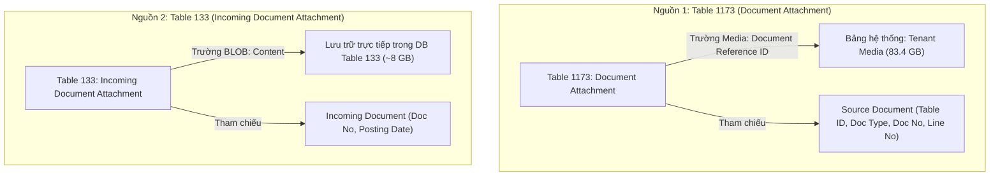
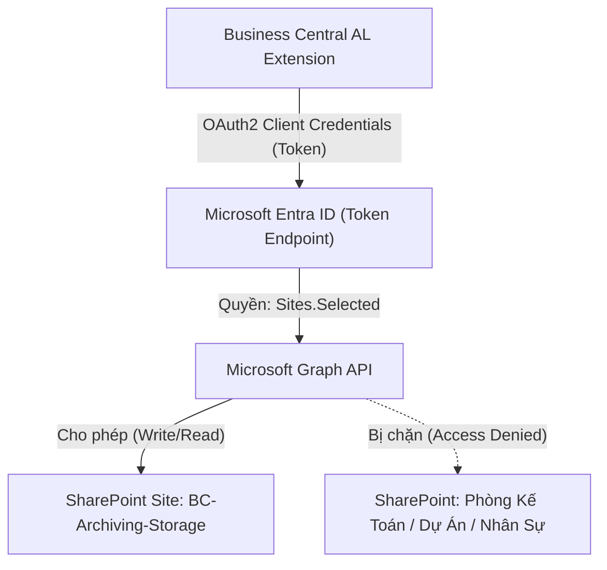
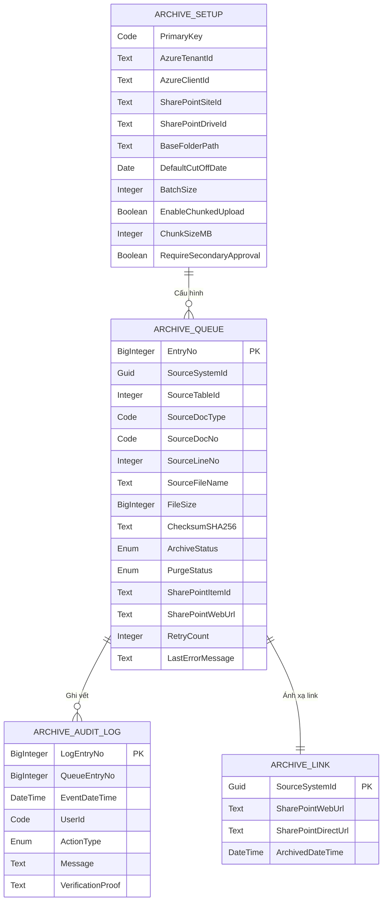
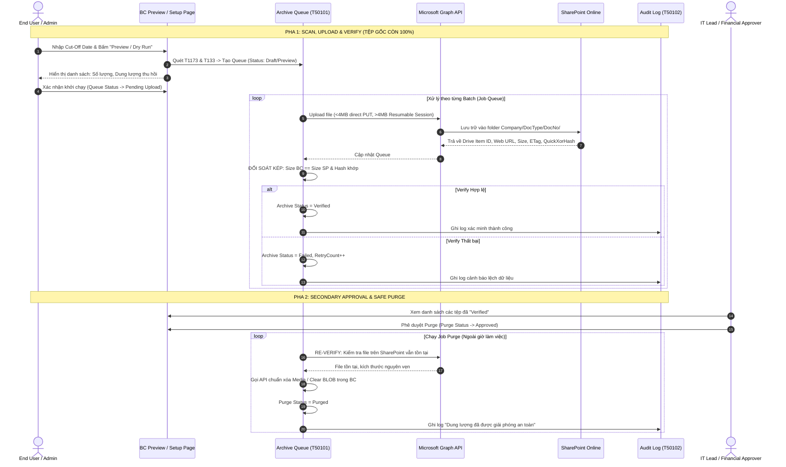

# TÀI LIỆU THIẾT KẾ KỸ THUẬT & MÔ HÌNH DỮ LIỆU

## Dự án: Business Central File Archiving to SharePoint

**Phiên bản:** 1.0 | **Trạng thái:** Chờ phê duyệt (Discovery & Technical Design)

---

## MỤC LỤC

1. [Tổng quan dự án & Bài toán dung lượng](#1-tổng-quan-dự-án--bài-toán-dung-lượng)
2. [Nguyên tắc cốt lõi & Giới hạn đỏ (Safety Guardrails)](#2-nguyên-tắc-cốt-lõi--giới-hạn-đỏ-safety-guardrails)
3. [Khảo sát dữ liệu nguồn & Cơ chế ánh xạ (Attachment Mapping)](#3-khảo-sát-dữ-liệu-nguồn--cơ-chế-ánh-xạ-attachment-mapping)
4. [Kiến trúc bảo mật & Xác thực Microsoft Entra / Graph API](#4-kiến-trúc-bảo-mật--xác-thực-microsoft-entra--graph-api)
5. [Quy chuẩn lưu trữ & Cấu trúc thư mục SharePoint](#5-quy-chuẩn-lưu-trữ--cấu-trúc-thư-mục-sharepoint)
6. [Chi tiết Mô hình Dữ liệu (Data Model AL Extension)](#6-chi-tiết-mô-hình-dữ-liệu-data-model-al-extension)
7. [Đặc tả Quy trình 2 Pha (Upload vs. Purge Workflow)](#7-đặc-tả-quy-trình-2-pha-upload-vs-purge-workflow)
8. [Cơ chế Chống lỗi, Throttling & Khôi phục sự cố (Resilience & Recovery)](#8-cơ-chế-chống-lỗi-throttling--khôi-phục-sự-cố-resilience--recovery)
9. [Kế hoạch Kiểm thử & Bộ tiêu chí Nghiệm thu (Test Plan)](#9-kế-hoạch-kiểm-thử--bộ-tiêu-chí-nghiệm-thu-test-plan)

---

## 1. TỔNG QUAN DỰ ÁN & BÀI TOÁN DUNG LƯỢNG

### 1.1. Bối cảnh & Hiện trạng

Hệ thống Dynamics 365 Business Central (Cloud SaaS) đang vượt ngưỡng dung lượng được cấp phát:

- **Tổng dung lượng sử dụng:** **218.45 GB** / Hạn mức **110 GB** (Vượt quá 198%).
- **Cơ sở dữ liệu Production:** ~97.05 GB.
- **Tenant Media:** ~**83.4 GB** trên 191,199 records (chiếm hơn 38% tổng dung lượng).
- **Incoming Document Attachments (APSS-SG):** ~**4.05 GB** trên 19,413 records.
- **Incoming Document Attachments (Test SG08):** ~**3.96 GB** trên 18,819 records.

### 1.2. Mục tiêu kỹ thuật

1. Di dời nội dung nhị phân (binary content) của các tệp đính kèm cũ hơn ngày cut-off do người dùng chỉ định sang Microsoft SharePoint Online.
2. Giữ nguyên 100% tính toàn vẹn, khả năng truy cập (SharePoint Link) và lịch sử kiểm toán trực tiếp từ màn hình Business Central.
3. Giải phóng dung lượng database an toàn, **không làm đứt gãy tham chiếu của hệ thống**, không gây gián đoạn sản xuất.

---

## 2. NGUYÊN TẮC CỐT LÕI & GIỚI HẠN ĐỎ (SAFETY GUARDRAILS)

> [!CAUTION]
> **CÁC NGUYÊN TẮC BẮT BUỘC KHÔNG ĐƯỢC VI PHẠM:**
>
> 1. **TUYỆT ĐỐI KHÔNG thao tác hoặc xóa trực tiếp trên bảng hệ thống `Tenant Media` hay sử dụng Direct SQL.** Mọi thao tác phải thông qua API và Record chuẩn của BC để BC tự quản lý reference count và dọn dẹp an toàn.
> 2. **TUYỆT ĐỐI KHÔNG can thiệp vào các bảng nghiệp vụ và chứng từ lưu trữ:**
>    - `Sales Header Archive` / `Sales Line Archive` (Table 5107, 5108)
>    - `Purchase Header Archive` / `Purchase Line Archive` (Table 5109, 5110)
>    - APSS SQ-to-PQ archive records
>    - Toàn bộ bảng hạch toán kế toán / giao dịch (`G/L Entry`, `Cust. Ledger Entry`, v.v.)
>    - System Media và Application Media
> 3. **Không chỉnh sửa trực tiếp mã nguồn Production của APSS.** Đóng gói 100% giải pháp vào một **AL Extension độc lập**.
> 4. **Tách rời tuyệt đối 2 pha: Upload vs. Purge.** Không bao giờ xóa file trên BC ngay sau khi upload nếu chưa qua bước phê duyệt độc lập (Secondary Approval).

---

## 3. KHẢO SÁT DỮ LIỆU NGUỒN & CƠ CHẾ ÁNH XẠ (ATTACHMENT MAPPING)

Dự án xử lý 2 nguồn dữ liệu tệp đính kèm có kiến trúc lưu trữ khác nhau:



### 3.1. Bảng 1: `Document Attachment` (Table 1173)

- **Khóa chính (PK):** `Table ID`, `Number` (Doc No), `Document Type`, `Line No.`, `ID`.
- **Cơ chế lưu trữ:** Trường `Document Reference ID` có kiểu dữ liệu `Media`. Dữ liệu nhị phân thực tế nằm trong bảng `Tenant Media`.
- **Rủi ro Shared Media:** Khi chứng từ được Post (ví dụ Sales Order $\rightarrow$ Posted Sales Invoice), BC sao chép bản ghi đính kèm nhưng **giữ nguyên cùng một Media GUID**. Nếu xóa trực tiếp `Tenant Media`, cả 2 chứng từ đều mất file.
- **Cách giải phóng an toàn:** Gọi method chuẩn `DocumentAttachment."Document Reference ID".Remove()` hoặc clear field trên record rồi `Modify()`. Khi tất cả các record trỏ đến Media GUID đó bị clear, BC runtime sẽ tự động giải phóng dung lượng trong `Tenant Media`.

### 3.2. Bảng 2: `Incoming Document Attachment` (Table 133)

- **Khóa chính (PK):** `Incoming Document Entry No.`, `Line No.`.
- **Cơ chế lưu trữ:** Trường `Content` có kiểu dữ liệu **`BLOB`**. Không sử dụng `Tenant Media`.
- **Cách giải phóng an toàn:** Gọi `Clear(IncomingDocAttachment.Content)` và cập nhật trạng thái thông qua Codeunit quản lý `Incoming Document Attachment Mgt.`.

### 3.3. Chiến lược xác định ngày (Source Date vs. Cut-off Date)

| Bảng nguồn                             | Trường ngày đề xuất so sánh                                                                                                               | Cơ sở nghiệp vụ                                                                                                                        |
| :------------------------------------- | :---------------------------------------------------------------------------------------------------------------------------------------- | :------------------------------------------------------------------------------------------------------------------------------------- |
| **Document Attachment** (1173)         | 1. Ưu tiên: Ngày của Source Document (`Posting Date` / `Document Date`).<br>2. Fallback: `Attached Date` trên chính bản ghi attachment.   | Đảm bảo các hóa đơn/đơn hàng đã hạch toán từ lâu mới bị archive, không phụ thuộc vào việc ai đó vô tình tải lại file vào ngày gần đây. |
| **Incoming Document Attachment** (133) | 1. Ưu tiên: `Posting Date` hoặc `Document Date` trên `Incoming Document` (Table 130).<br>2. Fallback: `Created Date-Time` trên Table 133. | Phản ánh đúng niên độ kế toán của chứng từ đầu vào.                                                                                    |

---

## 4. KIẾN TRÚC BẢO MẬT & XÁC THỰC MICROSOFT ENTRA / GRAPH API

### 4.1. Nguyên tắc Đặc quyền Tối thiểu (Least Privilege)

Tuyệt đối **KHÔNG** sử dụng quyền Application rộng `Files.ReadWrite.All` (vì sẽ có quyền đọc/ghi mọi tài liệu trong toàn bộ tenant Microsoft 365).

**Mô hình phân quyền chuẩn Enterprise:**

1. Đăng ký một **App Registration (Service Principal)** trên Microsoft Entra ID.
2. Gán quyền Application: **`Sites.Selected`** (Microsoft Graph).
3. Sử dụng Graph API (hoặc PowerShell) để cấp quyền **`write` (contribute)** cho duy nhất Service Principal này trên **chính xác 1 SharePoint Site Collection** dành riêng cho lưu trữ BC.
4. Mọi yêu cầu truy cập vào các SharePoint Site khác của công ty sẽ bị Entra ID từ chối ngay lập tức (HTTP 403 Forbidden).



### 4.2. Quản lý Credentials & Chống thất thoát Secret

- **Phương thức xác thực:** Hỗ trợ cả **Client Secret** và **Client Certificate (.pfx / Base64)**. Khuyến nghị dùng Certificate cho môi trường Production.
- **Lưu trữ bảo mật trong BC:**
  - **Tuyệt đối không lưu plain text** Client Secret trong bất kỳ Table field nào.
  - Toàn bộ Secret/Private Key được lưu trữ bằng API **`IsolatedStorage`** của AL với phạm vi `DataScope::Company` hoặc `DataScope::Module`.
  - Trên UI thiết lập (Setup Page), các trường nhập liệu có thuộc tính `ExtendedDatatype = Masked`.

### 4.3. Bảo mật Phía SharePoint (Data Loss Prevention)

- **Quyền hạn End-User:** Người dùng thông thường từ BC chỉ được cấp quyền **Read-Only** trên Document Library lưu trữ để ngăn chặn người dùng vô tình hoặc cố ý xóa/sửa file lưu trữ.
- **SharePoint Versioning & Retention:** Bật tính năng **Retention Label / Legal Hold** trên thư viện lưu trữ để đảm bảo tệp tin là bất biến (WORM - Write Once, Read Many) phục vụ kiểm toán tài chính.

---

## 5. QUY CHUẨN LƯU TRỮ & CẤU TRÚC THƯ MỤC SHAREPOINT

### 5.1. Cấu trúc cây thư mục (Folder Hierarchy)

Để chống trùng lặp `Document No.` giữa các pháp nhân (Company) trong cùng một BC Tenant, cấu trúc lưu trữ được chuẩn hóa như sau:

$$\mathbf{\text{[Archive Document Library]}} \;/\; \mathbf{\text{[Company Name]}} \;/\; \mathbf{\text{[Document Type]}} \;/\; \mathbf{\text{[Document No.]}} \;/\; \mathbf{\text{[File Name]}}$$

_Ví dụ:_
`BC-Archive-Lib / APSS-SG / Posted Sales Invoice / INV-2022-00129 / Contract_Signed.pdf`

### 5.2. Quy tắc làm sạch (Sanitization Rules)

SharePoint Online có các giới hạn nghiêm ngặt về ký tự và đường dẫn:

1. **Ký tự cấm tuyệt đối:** `~`, `"`, `#`, `%`, `&`, `*`, `:`, `<`, `>`, `?`, `/`, `\`, `{`, `|`, `}`
2. **Quy tắc chuẩn hóa:**
   - Thay thế tất cả ký tự cấm và ký tự điều khiển bằng dấu gạch dưới `_`.
   - Cắt bỏ khoảng trắng ở đầu/cuối tên folder và file.
   - Xóa dấu chấm `.` ở cuối tên folder hoặc tên file (ví dụ `folder.` $\rightarrow$ `folder_`).
   - **Chống Path Traversal:** Loại bỏ toàn bộ chuỗi `../` hoặc `..\` trong `Document No.`.
3. **Giới hạn độ dài URL:** Tổng độ dài đường dẫn URL trên SharePoint không được vượt quá **400 ký tự**. Nếu tên file hoặc tên chứng từ quá dài, hệ thống tự động cắt ngắn an toàn và bảo toàn đuôi mở rộng (extension).

### 5.3. Xử lý trùng tên file (Duplicate File Name)

Nếu trong cùng một chứng từ có nhiều file cùng tên (ví dụ: đính kèm 2 file `Invoice.pdf` vào các dòng khác nhau):

- Tự động bổ sung hậu tố định danh dựa trên `Line No.` hoặc ID:  
  `Invoice.pdf` $\rightarrow$ `Invoice_[LineNo].pdf` (hoặc `Invoice_[SystemId_Short].pdf`).
- Tuyệt đối không để SharePoint tự động sinh `Invoice (1).pdf` ngoài tầm kiểm soát của BC.

---

## 6. CHI TIẾT MÔ HÌNH DỮ LIỆU (DATA MODEL AL EXTENSION)

Hệ thống được thiết kế hoàn toàn trên các bảng độc lập, thuộc dải ID đã đăng ký trong `app.json` (`50100 .. 50149`), không làm ô nhiễm schema chuẩn.



### 6.1. Bảng 1: `Archive Setup` (Table 50100)

Bảng Singleton lưu cấu hình toàn hệ thống:

```al
table 50100 "Archive Setup"
{
    DataClassification = CustomerContent;
    Caption = 'Archive Setup';

    fields
    {
        field(1; "Primary Key"; Code[10])
        {
            Caption = 'Primary Key';
        }
        field(10; "Tenant ID"; Text[50])
        {
            Caption = 'Microsoft Entra Tenant ID';
        }
        field(11; "Client ID"; Text[50])
        {
            Caption = 'App Registration Client ID';
        }
        field(12; "SharePoint Site ID"; Text[150])
        {
            Caption = 'SharePoint Site ID (Graph)';
        }
        field(13; "SharePoint Drive ID"; Text[150])
        {
            Caption = 'Document Library (Drive ID)';
        }
        field(14; "Base Folder Path"; Text[250])
        {
            Caption = 'Base Folder Path';
        }
        field(20; "Default Cut-Off Date"; Date)
        {
            Caption = 'Default Cut-Off Date';
        }
        field(21; "Batch Size"; Integer)
        {
            Caption = 'Batch Size (per Job Run)';
            InitValue = 100;
        }
        field(22; "Chunk Size (MB)"; Integer)
        {
            Caption = 'Chunk Size for Resumable Upload (MB)';
            InitValue = 4;
            MinValue = 4;
            MaxValue = 60;
        }
        field(30; "Require Secondary Approval"; Boolean)
        {
            Caption = 'Require Secondary Approval for Purge';
            InitValue = true;
        }
        field(31; "Purge Retention Days"; Integer)
        {
            Caption = 'Delay Days between Upload and Purge';
            InitValue = 7;
        }
        field(40; "Is Configured"; Boolean)
        {
            Caption = 'Is Configured';
        }
    }

    keys
    {
        key(PK; "Primary Key")
        {
            Clustered = true;
        }
    }
}
```

### 6.2. Bảng 2: `Archive Queue Entry` (Table 50101)

Bảng cốt lõi quản lý hàng đợi, trạng thái tải và kiểm toán kỹ thuật:

```al
table 50101 "Archive Queue Entry"
{
    DataClassification = CustomerContent;
    Caption = 'Archive Queue Entry';

    fields
    {
        field(1; "Entry No."; BigInteger)
        {
            AutoIncrement = true;
            Caption = 'Entry No.';
        }
        field(2; "Source SystemId"; Guid)
        {
            Caption = 'Source Record SystemId (Attachment)';
        }
        field(3; "Source Table ID"; Integer)
        {
            Caption = 'Source Table ID';
        }
        field(4; "Source Document Type"; Code[30])
        {
            Caption = 'Document Type';
        }
        field(5; "Source Document No."; Code[50])
        {
            Caption = 'Document No.';
        }
        field(6; "Source Line No."; Integer)
        {
            Caption = 'Line No.';
        }
        field(7; "Source ID"; Integer)
        {
            Caption = 'Attachment ID';
        }
        field(10; "File Name"; Text[250])
        {
            Caption = 'Original File Name';
        }
        field(11; "File Extension"; Text[30])
        {
            Caption = 'File Extension';
        }
        field(12; "File Size (Bytes)"; BigInteger)
        {
            Caption = 'File Size (Bytes)';
        }
        field(13; "File Checksum (Hash)"; Text[64])
        {
            Caption = 'File Checksum / QuickXorHash';
        }
        field(20; "Archive Status"; Enum "Archive Process Status")
        {
            Caption = 'Archive Status';
        }
        field(21; "Purge Status"; Enum "Purge Process Status")
        {
            Caption = 'Purge Status';
        }
        field(30; "SharePoint Relative Path"; Text[500])
        {
            Caption = 'SharePoint Relative Path';
        }
        field(31; "SharePoint Item ID"; Text[250])
        {
            Caption = 'SharePoint Drive Item ID';
        }
        field(32; "SharePoint Web URL"; Text[1000])
        {
            Caption = 'SharePoint Web URL';
            ExtendedDatatype = URL;
        }
        field(33; "SharePoint ETag"; Text[150])
        {
            Caption = 'SharePoint ETag';
        }
        field(40; "Retry Count"; Integer)
        {
            Caption = 'Retry Count';
            InitValue = 0;
        }
        field(41; "Max Retries"; Integer)
        {
            Caption = 'Max Retries';
            InitValue = 5;
        }
        field(42; "Last Error Message"; Text[1000])
        {
            Caption = 'Last Error Message';
        }
        field(50; "Uploaded DateTime"; DateTime)
        {
            Caption = 'Uploaded DateTime';
        }
        field(51; "Verified DateTime"; DateTime)
        {
            Caption = 'Verified DateTime';
        }
        field(52; "Purged DateTime"; DateTime)
        {
            Caption = 'Purged DateTime';
        }
        field(60; "Source Record Exists"; Boolean)
        {
            Caption = 'Source Document Exists';
            InitValue = true;
        }
        field(61; "Is Dry Run"; Boolean)
        {
            Caption = 'Is Dry Run Record';
        }
    }

    keys
    {
        key(PK; "Entry No.")
        {
            Clustered = true;
        }
        key(Idx_Source; "Source SystemId")
        {
            Unique = true;
        }
        key(Idx_Status; "Archive Status", "Purge Status")
        {
        }
        key(Idx_Doc; "Source Table ID", "Source Document No.")
        {
        }
    }
}
```

### 6.3. Bảng 3: `Archive Audit Log` (Table 50102)

Bảng nhật ký kiểm toán bất biến (Append-Only), phục vụ đối soát pháp lý:

```al
table 50102 "Archive Audit Log"
{
    DataClassification = CustomerContent;
    Caption = 'Archive Audit Log';

    fields
    {
        field(1; "Log Entry No."; BigInteger)
        {
            AutoIncrement = true;
            Caption = 'Log Entry No.';
        }
        field(2; "Queue Entry No."; BigInteger)
        {
            Caption = 'Queue Entry No.';
            TableRelation = "Archive Queue Entry"."Entry No.";
        }
        field(3; "Event DateTime"; DateTime)
        {
            Caption = 'Event Date Time';
        }
        field(4; "User ID"; Code[50])
        {
            Caption = 'User ID';
            DataClassification = EndUserIdentifiableInformation;
        }
        field(5; "Action Type"; Enum "Archive Audit Action")
        {
            Caption = 'Action Type';
        }
        field(6; "Old Status"; Text[50])
        {
            Caption = 'Old Status';
        }
        field(7; "New Status"; Text[50])
        {
            Caption = 'New Status';
        }
        field(10; "Message"; Text[1000])
        {
            Caption = 'Log Message';
        }
        field(11; "Verification Proof"; Text[500])
        {
            Caption = 'Verification Proof (Size/Hash/ETag)';
        }
    }

    keys
    {
        key(PK; "Log Entry No.")
        {
            Clustered = true;
        }
        key(Idx_Queue; "Queue Entry No.")
        {
        }
    }
}
```

### 6.4. Bảng 4: `Archive Link Mapping` (Table 50103)

Bảng lưu trữ liên kết SharePoint, cho phép người dùng mở file từ BC mà không làm thay đổi các bảng chuẩn:

```al
table 50103 "Archive Link Mapping"
{
    DataClassification = CustomerContent;
    Caption = 'Archive Link Mapping';

    fields
    {
        field(1; "Attachment SystemId"; Guid)
        {
            Caption = 'Attachment SystemId';
        }
        field(2; "Source Table ID"; Integer)
        {
            Caption = 'Source Table ID';
        }
        field(3; "Document No."; Code[50])
        {
            Caption = 'Document No.';
        }
        field(4; "File Name"; Text[250])
        {
            Caption = 'File Name';
        }
        field(10; "SharePoint Web URL"; Text[1000])
        {
            Caption = 'SharePoint Web URL';
            ExtendedDatatype = URL;
        }
        field(11; "Is Purged In BC"; Boolean)
        {
            Caption = 'Is Purged In BC';
        }
        field(12; "Archived DateTime"; DateTime)
        {
            Caption = 'Archived Date Time';
        }
    }

    keys
    {
        key(PK; "Attachment SystemId")
        {
            Clustered = true;
        }
        key(Idx_Doc; "Source Table ID", "Document No.")
        {
        }
    }
}
```

### 6.5. Các Enum Trạng thái

- **`Archive Process Status` (Enum 50100):**
  - `0: Draft / Preview` (Chỉ hiển thị Dry-run)
  - `1: Pending Upload` (Chờ tải lên)
  - `2: Uploading` (Đang tải tệp)
  - `3: Uploaded` (Đã tải xong, chờ verify)
  - `4: Verified` (Đã xác minh size/hash thành công 100%)
  - `5: Failed` (Lỗi tải/verify)
  - `6: Skipped / Orphan` (Bỏ qua do thiếu chứng từ nguồn)
- **`Purge Process Status` (Enum 50101):**
  - `0: Not Eligible` (Chưa được phép purge)
  - `1: Pending Approval` (Đang chờ phê duyệt cấp 2)
  - `2: Approved` (Đã phê duyệt, chờ lệnh dọn dẹp)
  - `3: Purged` (Đã giải phóng nội dung an toàn trong BC)
  - `4: Purge Failed` (Lỗi trong quá trình dọn dẹp)
- **`Archive Audit Action` (Enum 50102):**
  - `Preview`, `Queued`, `Upload Started`, `Upload Succeeded`, `Verify Succeeded`, `Verify Failed`, `Purge Approved`, `Purge Rejected`, `Purge Completed`, `Rollback Restored`.

---

## 7. ĐẶC TẢ QUY TRÌNH 2 PHA (UPLOAD VS. PURGE WORKFLOW)



### 7.1. Cơ chế Chunked Upload (Tệp lớn > 4 MB)

1. Kiểm tra kích thước file:
   - Nếu $\le 4\text{ MB}$: Sử dụng Simple Upload (`PUT /drives/{drive-id}/items/{parent-id}:/{filename}:/content`).
   - Nếu $> 4\text{ MB}$: Khởi tạo **Upload Session** qua Graph API (`createUploadSession`), chia file thành các chunk (mỗi chunk 4 MB) và upload tuần tự.
2. Nếu mạng bị ngắt giữa chừng trong lúc upload chunk: Graph API hỗ trợ query status của session để upload tiếp từ byte bị đứt đoạn mà không cần upload lại từ đầu.

---

## 8. CƠ CHẾ CHỐNG LỖI, THROTTLING & KHÔI PHỤC SỰ CỐ (RESILIENCE & RECOVERY)

### 8.1. Xử lý Giới hạn Băng thông (Graph Throttling - HTTP 429)

- Khi SharePoint/Graph bị quá tải, API sẽ trả về mã lỗi `HTTP 429 (Too Many Requests)` kèm header `Retry-After: <seconds>`.
- **Cơ chế xử lý trong AL:**
  1. Bắt mã HTTP 429 hoặc HTTP 503.
  2. Đọc giá trị header `Retry-After` (mặc định lùi lại $10\text{s}, 20\text{s}, 40\text{s}$ theo cơ chế Exponential Backoff).
  3. Đưa bản ghi vào trạng thái tạm dừng, chuyển lượt xử lý cho Job Queue kế tiếp, không spam request làm khóa tenant.

### 8.2. Khắc phục lỗi bất đối xứng mạng (Network Disconnect Recovery)

- **Kịch bản:** File đã upload thành công lên SharePoint nhưng mạng rớt, BC chưa kịp commit trạng thái `Verified`.
- **Khắc phục:** Trước khi gửi lệnh upload bất kỳ file nào, hệ thống luôn gọi Graph API kiểm tra tệp tại đường dẫn đích:
  - Nếu file đã tồn tại trên SharePoint và có kích thước khớp 100% với BC $\rightarrow$ Hệ thống lập tức thu hồi `Item ID`, `Web URL`, chuyển trạng thái thành `Verified` mà không upload đè.

### 8.3. Khôi phục thảm họa (Disaster Recovery & Rollback)

- Trong bảng `Archive Link Mapping`, hệ thống luôn lưu trữ URL và Item ID gốc.
- Nếu xảy ra sự cố khẩn cấp (ví dụ người dùng cần phục hồi lại tệp nhị phân vào BC):
  - Cung cấp Action **"Restore Attachment to BC"**: Codeunit sẽ đọc stream từ SharePoint thông qua Graph API và ghi ngược lại vào trường `Document Reference ID` (Table 1173) hoặc `Content` (Table 133).

---

## 9. KẾ HOẠCH KIỂM THỬ & BỘ TIÊU CHÍ NGHIỆM THU (TEST PLAN)

Mọi hoạt động kiểm thử phải được tiến hành trên môi trường **Sandbox tạo từ bản sao (copy) của Production**:

|    STT    | Kịch bản kiểm thử (Test Case)        | Dữ liệu đầu vào / Điều kiện                                  | Kết quả kỳ vọng (Expected Result)                                                                                                                                        |
| :-------: | :----------------------------------- | :----------------------------------------------------------- | :----------------------------------------------------------------------------------------------------------------------------------------------------------------------- |
| **TC-01** | Kiểm tra chế độ Dry-Run (Preview)    | Nhập Cut-off date là ngày 31/12/2023.                        | Hệ thống chỉ hiển thị danh sách xem trước, tổng số file, dung lượng dự kiến. **Không có file nào bị upload, không có dữ liệu nào bị thay đổi.**                          |
| **TC-02** | Upload file nhỏ thông thường         | File PDF kích thước 500 KB đính kèm tại Posted Invoice.      | Upload thành công vào đúng folder `APSS-SG / Posted Sales Invoice / INV... / File.pdf`. URL được ghi nhận vào BC. File trong BC vẫn mở được.                             |
| **TC-03** | Upload file lớn (Chunked Upload)     | File bản vẽ/hợp đồng quét 45 MB.                             | Upload session hoạt động trơn tru qua từng chunk 4 MB. Kích thước trên SharePoint khớp từng byte với BC.                                                                 |
| **TC-04** | Ký tự cấm và đường dẫn dài           | Tên file chứa `~#%&*{}`, Doc No chứa `/`.                    | Hệ thống tự động làm sạch ký tự thành `_`, đường dẫn hợp lệ, upload không bị lỗi 400 Bad Request.                                                                        |
| **TC-05** | Trùng tên file trong cùng chứng từ   | Đính kèm 2 file cùng tên `Receipt.jpg` vào 2 dòng khác nhau. | File thứ 2 tự động thêm hậu tố `Receipt_Line2.jpg`, cả 2 file đều tồn tại độc lập trên SharePoint.                                                                       |
| **TC-06** | Thử nghiệm ngắt kết nối mạng giả lập | Ngắt kết nối trong lúc đang upload.                          | Bản ghi ghi nhận trạng thái lỗi, `Retry Count` tăng lên. Lần chạy sau tiếp tục từ file lỗi mà không bị nhân bản file rác.                                                |
| **TC-07** | Thử nghiệm Phê duyệt Purge an toàn   | Lô 100 file đã `Verified`.                                   | Không thể purge nếu chưa có cờ `Approved`. Sau khi phê duyệt và chạy purge, trường `Media` / `BLOB` trong BC được dọn sạch, link SharePoint vẫn bấm mở file bình thường. |
| **TC-08** | Đo lường giải phóng dung lượng       | Chạy toàn bộ quy trình trên Sandbox.                         | Dung lượng `Tenant Media` và dung lượng bảng `Incoming Document Attachment` giảm tương ứng với kích thước các file đã archive.                                           |

---

## 10. TRẠNG THÁI HIỆN TẠI & BƯỚC TIẾP THEO.

- **Tiến độ mã nguồn:** Đang giữ nguyên trạng thái **chưa viết code** theo đúng chỉ đạo.
