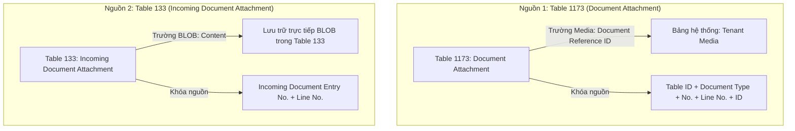
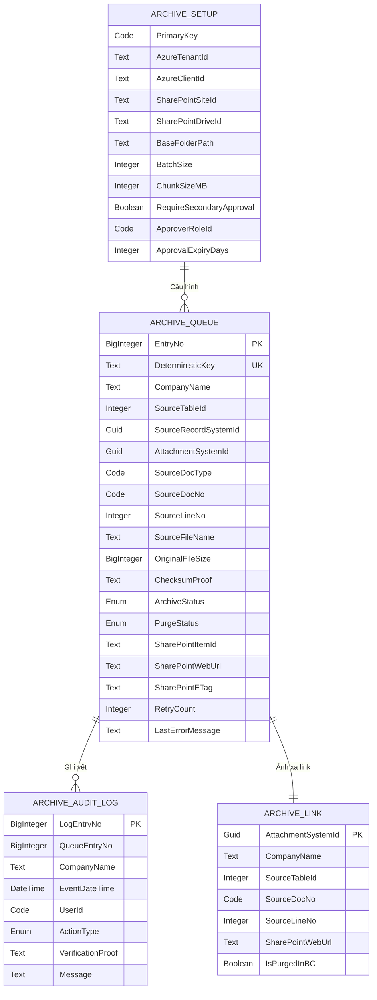
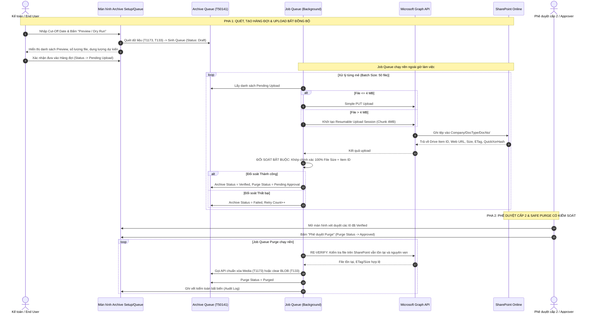

# TÀI LIỆU THIẾT KẾ KỸ THUẬT & MÔ HÌNH DỮ LIỆU

## Dự án: Business Central File Archiving to SharePoint

**Phiên bản:** 1.3 | **Trạng thái:** Chờ phê duyệt (Discovery & Technical Design - Đã xác minh Test 1 & Test 2 thực tế; Chốt dải ID 50140..50189 & Ngữ cảnh Đa công ty)  
**Phạm vi:** Dynamics 365 Business Central Cloud SaaS (v28) & Microsoft SharePoint Online

---

## MỤC LỤC

1. [Tổng quan dự án & Phân loại dung lượng thực tế](#1-tổng-quan-dự-án--phân-loại-dung-lượng-thực-tế)
2. [Nguyên tắc cốt lõi & Giới hạn đỏ (Safety Guardrails)](#2-nguyên-tắc-cốt-lõi--giới-hạn-đỏ-safety-guardrails)
3. [Khảo sát dữ liệu nguồn & Xác minh Schema BC v28](#3-khảo-sát-dữ-liệu-nguồn--xác-minh-schema-bc-v28)
4. [Bằng chứng Thực nghiệm Purge Media (Proof-of-Concept trên Sandbox)](#4-bằng-chứng-thực-nghiệm-purge-media-proof-of-concept-trên-sandbox)
5. [Kiến trúc bảo mật & Xác thực Microsoft Entra / Graph API](#5-kiến-trúc-bảo-mật--xác-thực-microsoft-entra--graph-api)
6. [Quy chuẩn lưu trữ, Cấu trúc thư mục & Chính sách SharePoint](#6-quy-chuẩn-lưu-trữ-cấu-trúc-thư-mục--chính-sách-sharepoint)
7. [Chi tiết Mô hình Dữ liệu (Data Model AL Extension v1.1)](#7-chi-tiết-mô-hình-dữ-liệu-data-model-al-extension-v11)
8. [Thiết kế Giao diện Người dùng trong BC (UI Integration & Access Link)](#8-thiết-kế-giao-diện-người-dùng-trong-bc-ui-integration--access-link)
9. [Đặc tả Quy trình Bất đồng bộ 2 Pha (Async Pipeline Specification)](#9-đặc-tả-quy-trình-bất-đồng-bộ-2-pha-async-pipeline-specification)
10. [Cơ chế Chống lỗi, Throttling & Khử trùng lặp (Resilience & Idempotency)](#10-cơ-chế-chống-lỗi-throttling--khử-trùng-lặp-resilience--idempotency)
11. [Kế hoạch Kiểm thử Mở rộng (23 Test Cases bao gồm Rủi ro Production)](#11-kế-hoạch-kiểm-thử-mở-rộng-23-test-cases-bao-gồm-rủi-ro-production)

---

## 1. TỔNG QUAN DỰ ÁN & PHÂN LOẠI DUNG LƯỢNG THỰC TẾ

### 1.1. Hiện trạng Dung lượng Hệ thống

Hệ thống Dynamics 365 Business Central Cloud SaaS đang vượt hạn mức dung lượng được cấp:

- **Tổng dung lượng sử dụng:** **218.45 GB** / Hạn mức được cấp: **110 GB** (Vượt 198%).
- **Cơ sở dữ liệu Production:** ~97.05 GB.
- **Tenant Media:** ~**83.4 GB** trên 191,199 records (chiếm hơn 38% tổng dung lượng).
- **Incoming Document Attachments (APSS-SG):** ~**4.05 GB** trên 19,413 records.
- **Incoming Document Attachments (Test SG08):** ~**3.96 GB** trên 18,819 records.

### 1.2. Phân loại "Dung lượng có thể thu hồi" vs "Tổng Tenant Media"

> [!IMPORTANT]
> **CẢNH BÁO VỀ SỐ LIỆU:** Con số 83.4 GB của `Tenant Media` **KHÔNG ĐỒNG NGHĨA** với việc có thể thu hồi toàn bộ 83.4 GB này.
> Tuyệt đối không cam kết giải phóng toàn bộ 83.4 GB trước khi có báo cáo khảo sát (Discovery Report) phân loại chi tiết.

Cần thực hiện báo cáo điều tra (Discovery Query chỉ đọc) trên bản sao Sandbox để bóc tách 83.4 GB thành 5 nhóm:

1. **Media đang được `Document Attachment` (Table 1173) tham chiếu:** Đây là nhóm mục tiêu chính có thể archive.
2. **Media được nhiều attachment record dùng chung (Shared Media Reference):** Xuất hiện khi copy chứng từ hoặc post hóa đơn. Cần xác định tỷ lệ dùng chung để tránh tính trùng dung lượng thu hồi.
3. **Media không còn tham chiếu (Orphan Media):** Các file rác sót lại do xóa record nghiệp vụ trước đây nhưng BC chưa dọn ngầm. Nhóm này không có attachment record để điều phối archive.
4. **Media thuộc System, Application hoặc Extension khác:** Ảnh Item, Company Logo, User Picture, System Symbols, Report Layouts... Nhóm này **bắt buộc loại trừ 100%**.
5. **Media thỏa mãn điều kiện Cut-off Date:** Chỉ những file thuộc nhóm (1) có ngày chứng từ cũ hơn Cut-off date mới thực sự là dung lượng có thể thu hồi.

---

## 2. NGUYÊN TẮC CỐT LÕI & GIỚI HẠN ĐỎ (SAFETY GUARDRAILS)

> [!CAUTION]
> **CÁC NGUYÊN TẮC BẮT BUỘC TUÂN THỦ:**
>
> 1. **TUYỆT ĐỐI KHÔNG thao tác hoặc xóa trực tiếp trên bảng `Tenant Media` hay sử dụng Direct SQL.** Mọi thao tác phải thông qua API và Record chuẩn của BC để BC tự quản lý reference count.
> 2. **TUYỆT ĐỐI KHÔNG can thiệp vào các bảng nghiệp vụ và chứng từ lưu trữ:**
>    - `Sales Header Archive` / `Sales Line Archive` (Table 5107, 5108)
>    - `Purchase Header Archive` / `Purchase Line Archive` (Table 5109, 5110)
>    - APSS SQ-to-PQ archive records
>    - Toàn bộ sổ cái giao dịch/kế toán (`G/L Entry`, `Cust. Ledger Entry`, v.v.)
>    - System Media và Application Media
> 3. **Không chỉnh sửa trực tiếp mã nguồn Production của APSS.** Đóng gói giải pháp trong **AL Extension độc lập**.
> 4. **Tách rời tuyệt đối 2 pha: Upload vs. Purge.** Không bao giờ xóa file trên BC ngay sau khi upload nếu chưa qua quy trình phê duyệt (Secondary Approval Workflow).
> 5. **Loại bỏ tính năng Restore ra khỏi Phase 1 (MVP):** Không đưa "Restore Attachment to BC" vào giai đoạn đầu vì rủi ro tạo duplicate Media và ghi sai source record rất cao. Phase 1 chỉ tập trung vào: Preview $\rightarrow$ Queue $\rightarrow$ Upload $\rightarrow$ Verify $\rightarrow$ Retain Link $\rightarrow$ Approval $\rightarrow$ Purge $\rightarrow$ Audit.
> 6. **KHÓA CỨNG TÍNH NĂNG PURGE (HARD-LOCK PURGE GATEKEEPER):** Trong giai đoạn hiện tại, extension CHỈ CHO PHÉP thực thi: **Preview / Dry Run**, **Upload to SharePoint** và **Đối soát Verify (Size & Hash)**. Toàn bộ hành vi xóa nhị phân (Purge) bị khóa cứng cả ở tầng giao diện lẫn tầng nghiệp vụ (codeunit), tuyệt đối không xóa bất kỳ dữ liệu nào trên Production cho đến khi vượt qua đủ 5 điều kiện tiên quyết.
> 7. **XÁC MINH DẢI OBJECT ID (50140..50189) [ĐÃ HOÀN TẤT KIỂM TRA THỰC TẾ - TEST 1]:** Kết quả kiểm tra trực tiếp trên `Page 9100 "All Objects with Captions"` trên tenant APSS xác nhận: các object hiện tại đang chiếm dải `50100 .. 50136`. Từ ID **`50137` trở đi hoàn toàn trống (không có bất kỳ match nào)**. Dự án chính thức phân bổ và chốt dải ID an toàn **`50140 .. 50189`** (50 IDs) trong `app.json` cho toàn bộ Table, Page, Codeunit, Enum và PermissionSet của extension.

---

## 3. KHẢO SÁT DỮ LIỆU NGUỒN & XÁC MINH SCHEMA BC V28

Tránh mọi suy đoán lý thuyết, cấu trúc dữ liệu phải được đối chiếu trực tiếp từ symbol chuẩn của Business Central v28:



### 3.1. Xác minh Table 1173 (`Document Attachment`)

- **Khóa chính thực tế (PK):** `Table ID`, `Number`, `Document Type`, `Line No.`, `ID`.
- **Trường định danh bất biến:** `SystemId` (GUID) — Ổn định và duy nhất cho từng bản ghi attachment, phù hợp làm thành phần cấu tạo khóa Idempotency.
- **Trường chứa tệp nhị phân:** `Document Reference ID` (kiểu `Media`).
- **Rủi ro Shared Media:** Một GUID trong `Tenant Media` có thể được nhiều bản ghi `Document Attachment` tham chiếu tới (ví dụ: đính kèm file vào Sales Order, khi Post thì BC tự copy bản ghi sang Posted Sales Invoice nhưng giữ nguyên Media GUID).
- **Phương thức / API Purge chuẩn được phép dùng:**
  - Gọi `DocumentAttachment."Document Reference ID".Remove()` hoặc `Clear(DocumentAttachment."Document Reference ID")`, sau đó gọi `DocumentAttachment.Modify(false)`.
  - *Cảnh báo bắt buộc:* Tuyệt đối KHÔNG gọi `DocumentAttachment.Delete()` vì sẽ xóa mất dòng metadata đính kèm trên giao diện BC. Bắt buộc dùng `Modify(false)` để tránh kích hoạt các trigger can thiệp ngoài ý muốn của các extension khác.

### 3.2. Xác minh Table 133 (`Incoming Document Attachment`)

- **Khóa chính thực tế (PK):** `Incoming Document Entry No.`, `Line No.`.
- **Trường định danh bất biến:** `SystemId` (GUID).
- **Trường chứa tệp nhị phân:** `Content` (kiểu `BLOB`). Không liên kết với `Tenant Media`.
- **Phương thức / API Purge chuẩn được phép dùng:**
  - Sử dụng Codeunit chuẩn `Incoming Document Attachment Mgt.` hoặc xóa BLOB có kiểm soát bằng cách `Clear(IncomingDocAttachment.Content)` kết hợp cập nhật các trường cờ trạng thái liên quan, sau đó gọi `IncomingDocAttachment.Modify(false)`.


### 3.3. Chiến lược Cut-Off Date (Mở để chốt với Nghiệp vụ)

Quy tắc xác định ngày so khớp Cut-off date chưa chốt cứng mà được thiết kế thành cấu hình linh hoạt (Configurable Rule) để thảo luận tiếp với bộ phận Kế toán:

- **Lựa chọn A (Khuyến nghị cho Tài chính):** So khớp theo ngày hạch toán chứng từ gốc (`Posting Date`). Đảm bảo toàn bộ chứng từ thuộc niên độ kế toán đã đóng sổ mới bị archive.
- **Lựa chọn B:** So khớp theo ngày chứng từ (`Document Date`).
- **Lựa chọn C (Fallback kỹ thuật):** So khớp theo ngày đính kèm tệp (`Attached Date` trên Table 1173 hoặc `Created Date-Time` trên Table 133).

### 3.4. Nguyên tắc Ngữ cảnh Đa Pháp nhân (Company Context & ChangeCompany) [ĐÃ KIỂM THỬ THỰC TẾ - TEST 2]

> [!IMPORTANT]
> **KẾT QUẢ KIỂM NGHIỆM THỰC TẾ TRÊN TENANT APSS (TEST 2):**
> - **Kịch bản thực hiện:** Đã đính kèm 1 tệp vào Sales Order `APSS-SO-2404-054` tại công ty **`June9 Asia Pacific Solutions Supply Pte Ltd`**. Khi chuyển đổi ngữ cảnh sang công ty **`June9 APSS Viet Nam Co.,Ltd`**, mở danh sách Sales Order thì **hoàn toàn không tìm thấy** Sales Order `APSS-SO-2404-054` cũng như tệp đính kèm tương ứng.
> - **Bằng chứng xác nhận:** Dữ liệu chứng từ và file đính kèm được phân vùng hoàn toàn tách biệt giữa các pháp nhân (`DataPerCompany = true`).
> - **Hệ quả kiến trúc bắt buộc tuân thủ:**
>   1. Việc bổ sung trường `Company Name` vào bảng Queue hoặc Link Mapping làm thành phần khóa chính `("Company Name", "Attachment SystemId")` là **bắt buộc** để tránh xung đột dữ liệu chéo giữa các công ty con.
>   2. Tuy nhiên, thêm trường vào khóa chính **không tự động giải quyết việc truy vấn chéo giữa các công ty**. Trong toàn bộ logic xử lý (quét dữ liệu, đọc stream tệp, verify và purge), code AL **BẮT BUỘC** phải gọi lệnh chuyển ngữ cảnh công ty trước khi thao tác:
>      ```al
>      DocAttachment.ChangeCompany(ArchiveQueueEntry."Company Name");
>      if DocAttachment.Get(...) then ...
>      ```
>   3. Nếu bỏ qua `ChangeCompany`, Business Central sẽ mặc định đọc vào công ty hiện hành của phiên làm việc (session context), dẫn đến lỗi không tìm thấy bản ghi hoặc thao tác sai lệch trên dữ liệu của công ty khác.

---


## 4. BẰNG CHỨNG THỰC NGHIỆM PURGE MEDIA & KIỂM THỬ TIỀN TRIỂN KHAI (POC TRÊN SANDBOX)

> [!WARNING]
> Luận điểm _"Clear field trên Document Attachment thì BC tự giải phóng Tenant Media"_ bắt buộc phải được chứng minh bằng thực nghiệm PoC trên Sandbox trước khi viết code nghiệp vụ Purge.

### 4.1. Báo cáo Kết quả Kiểm thử Tiền Triển khai (Đã Thực nghiệm trên Tenant APSS)

| Mã Test | Nội dung Kiểm thử | Thực tế Ghi nhận trên Tenant APSS | Kết luận Kiến trúc |
| :---: | :--- | :--- | :--- |
| **Test 1** | Xác minh dải Object ID trên `Page 9100 "All Objects with Captions"` | Dải `50100 .. 50136` đã có object sử dụng trên tenant. **Từ `50137` trở đi hoàn toàn trống (không có bất kỳ match nào).** | **ĐẠT (PASSED).** Phân bổ và chốt cứng dải ID **`50140 .. 50189`** (50 IDs) trong `app.json`. |
| **Test 2** | Kiểm chứng phân vùng dữ liệu Đa Pháp nhân (`DataPerCompany`) | Đính kèm 1 file vào Sales Order `APSS-SO-2404-054` tại công ty `June9 Asia Pacific Solutions Supply Pte Ltd`. Chuyển sang công ty `June9 APSS Viet Nam Co.,Ltd` mở danh sách Sales Order: **hoàn toàn không tìm thấy Sales Order và tệp đính kèm**. | **ĐẠT (PASSED).** Xác nhận 100% dữ liệu phân vùng độc lập. Khóa chính `Archive Link Mapping` bắt buộc có `Company Name` và Job Queue bắt buộc gọi `ChangeCompany()`. |

### 4.2. Bộ Kịch bản Kiểm thử PoC Kế tiếp trên Sandbox (Thực hiện Trước khi Viết Code Extension)

Trước khi viết bất kỳ code logic Purge nào, cần thực hiện 2 kiểm thử nghiệm thu trực quan trên môi trường Sandbox:

#### 1. Test 3: Kiểm chứng Cơ chế Shared Media (Sales Order $\rightarrow$ Posted Sales Invoice)
- **Mục tiêu:** Xác định xem khi một Sales Order có đính kèm file được Post thành Posted Sales Invoice, BC có nhân đôi binary file trong `Tenant Media` hay dùng chung 1 Media GUID.
- **Quy trình thực hiện trên Sandbox:**
  1. Tạo 1 Sales Order nháp tại công ty `June9 Asia Pacific Solutions Supply Pte Ltd` (ví dụ `SO-TEST-POC01`).
  2. Bấm vào icon đính kèm (Attachments), đính kèm 1 file PDF bất kỳ.
  3. Mở trang `Document Attachment Details` (Page 1173), bật **Page Inspection** (`Ctrl + Alt + F1`):
     - Quan sát trường `Document Reference ID` (ghi lại chuỗi Media GUID, ví dụ: `{a1b2c3d4-...}`).
  4. Thực hiện Post Sales Order thành **Posted Sales Invoice** (hoặc Posted Sales Shipment).
  5. Mở Posted Sales Invoice vừa sinh ra $\rightarrow$ Mở `Document Attachment Details` $\rightarrow$ Bật Page Inspection:
     - Quan sát trường `Document Reference ID` trên bản ghi đính kèm của hóa đơn.
  6. **Đối soát:** Nếu GUID trùng khớp với GUID ở Sales Order $\rightarrow$ **Xác nhận 100% Shared Media**. Extension bắt buộc phải kiểm tra reference count trước khi dọn dẹp nhị phân.

#### 2. Test 4: Kiểm chứng Thao tác Clear Media / Non-destructive Purge
- **Mục tiêu:** Kiểm tra xem khi thực hiện `Clear(DocAttachment."Document Reference ID")` và `DocAttachment.Modify(false)`:
  - Dòng metadata (File Name, Extension) có còn hiển thị trên Page 1173 hay không?
  - UI có bị crash khi người dùng mở trang hay không?
- **Quy trình thực hiện trên Sandbox:**
  1. Chọn 1 chứng từ thử nghiệm đã đính kèm file trên Sandbox.
  2. Thực hiện lệnh kiểm thử xóa nhị phân có kiểm soát (qua action test hoặc codeunit test tối giản):
     ```al
     if DocAttachment.Get(TableId, DocNo, DocType, LineNo, AttachmentId) then begin
         Clear(DocAttachment."Document Reference ID");
         DocAttachment.Modify(false);
     end;
     ```
  3. Mở lại trang `Document Attachment Details` của chứng từ: Dòng đính kèm vẫn hiển thị đầy đủ tên file và metadata, giao diện chuẩn của BC không bị lỗi.
  4. Người dùng bấm xem file: BC sẽ thông báo file trống (hoàn toàn tương thích để chèn action `Open from SharePoint`).

### 4.3. Bộ 6 Kịch bản PoC Tổng thể Hoàn thiện
1. **Kịch bản 1: 1 Attachment — 1 Media GUID:** Tạo 1 attachment mới, kiểm tra `Tenant Media` có 1 record. Clear field `Document Reference ID` trên attachment $\rightarrow$ Xác minh xem record trong `Tenant Media` có bị xóa ngay hay chờ background process dọn dẹp.
2. **Kịch bản 2: Shared Media (Nhiều attachment trỏ vào 1 Media GUID):** Tạo 2 attachment trỏ vào cùng 1 Media GUID. Clear 1 attachment $\rightarrow$ **Xác minh attachment còn lại có bị lỗi không** và `Tenant Media` có bị xóa vội hay không. (Kỳ vọng: Media vẫn còn cho attachment thứ 2).
3. **Kịch bản 3: Post chứng từ (Copy từ Order sang Invoice):** Đã đặc tả chi tiết tại Test 3 ở trên.
4. **Kịch bản 4: Xóa Binary nhưng giữ Metadata:** Đã đặc tả chi tiết tại Test 4 ở trên.
5. **Kịch bản 5: Khởi động lại Service / Session mới:** Sau khi clear media, restart session và kiểm tra lại trạng thái.
6. **Kịch bản 6: Đo lường dung lượng thực tế:** Theo dõi trang _Admin Center > Capacity_ trước và sau khi purge (chú ý: BC Cloud cập nhật dung lượng có độ trễ từ vài giờ đến 24 giờ).

---

## 5. KIẾN TRÚC BẢO MẬT & XÁC THỰC MICROSOFT ENTRA / GRAPH API

### 5.1. Phân quyền Thực tế & Nguyên tắc Đặc quyền Tối thiểu (Sites.Selected)

- **Không dùng quyền diện rộng:** Tuyệt đối cấm quyền `Files.ReadWrite.All` trên Entra ID.
- **Mô hình triển khai chuẩn:**
  1. Phòng IT Doanh nghiệp tạo một **App Registration (Service Principal)** riêng cho tích hợp BC - SharePoint.
  2. Gán quyền Application: **`Sites.Selected`** (Microsoft Graph).
  3. Quản trị viên M365 dùng Graph API hoặc PowerShell để cấp quyền **`write` (contribute)** cho duy nhất App Registration này trên **đúng 1 SharePoint Site Collection** lưu trữ. Mọi hành vi truy cập site khác đều bị từ chối (HTTP 403).
  4. Tuyệt đối không dùng thông tin định danh (User Credentials) của cá nhân developer.

### 5.2. Quản lý Vòng đời Credentials & Mô hình Xác thực Được Phê Duyệt

Do Business Central Cloud SaaS (`Target = Cloud`) không cho phép sử dụng .NET Interop để tự giải mã tệp Private Key Certificate (.pfx), hệ thống chính thức áp dụng mô hình chuẩn hóa sau:

- **Mô hình Chính thức Áp dụng (Chuẩn M365 Native cho BC Cloud):**
  - Sử dụng **OAuth2 Client Credentials Grant Flow** với **Client Secret** (thời hạn đăng ký từ 1-2 năm).
  - Client Secret được lưu trữ an toàn trong **`IsolatedStorage`** của Business Central (DataScope::Company) với trường nhập liệu trên Setup Page có thuộc tính `ExtendedDatatype = Masked`.
  - Đây là mô hình chuẩn hóa, hiệu năng cao và native 100% trong AL Cloud, không làm phát sinh chi phí duy trì hạ tầng bổ sung.
- **Phương án Dự phòng (Nếu chính sách bảo mật bắt buộc dùng Certificate trong tương lai):**
  - Thiết lập dịch vụ ủy quyền trung gian an toàn (như **Azure Function** có gán Managed Identity hoặc liên kết **Azure Key Vault**). BC Extension sẽ gọi qua endpoint nội bộ an toàn của Azure Function để nhận Access Token của Graph API.
- **Cơ chế thu hồi (Revocation):** Thuộc trách nhiệm của bộ phận quản trị IT. Khi nghi ngờ lộ credential, quản trị viên chỉ cần xóa Secret trên Microsoft Entra ID là toàn bộ tiến trình upload lập tức dừng lại an toàn.


---

## 6. QUY CHUẨN LƯU TRỮ, CẤU TRÚC THƯ MỤC & CHÍNH SÁCH SHAREPOINT

### 6.1. Cấu trúc Cây Thư mục

Nhằm chống trùng lặp số chứng từ giữa các công ty con (ví dụ APSS-SG và APSS-VN đều có thể có hóa đơn `INV-2023-0001`):

$$\mathbf{\text{[Archive Document Library]}} \;/\; \mathbf{\text{[Company Name]}} \;/\; \mathbf{\text{[Document Type]}} \;/\; \mathbf{\text{[Document No.]}} \;/\; \mathbf{\text{[File Name]}}$$

### 6.2. Quy tắc Làm sạch Đường dẫn (Sanitization)

- Loại bỏ toàn bộ ký tự cấm của SharePoint: `~ " # % & * : < > ? / \ { | }` $\rightarrow$ Thay thế bằng dấu gạch dưới `_`.
- Xóa khoảng trắng và dấu chấm `.` ở đầu hoặc cuối tên thư mục và tên file.
- Chống tấn công Path Traversal: Loại bỏ triệt để chuỗi `../` hoặc `..\` trong `Document No.`.
- Kiểm soát độ dài: Tổng độ dài URL trên SharePoint $\le 400$ ký tự.

### 6.3. Chính sách Thư viện SharePoint (Retention & Permissions)

- **Phân quyền End-User:** Người dùng thông thường trong công ty chỉ có quyền **Read-Only** trên thư viện lưu trữ. Không có quyền sửa hoặc xóa file.
- **Phân quyền Service Principal (BC Bot):** Chỉ có quyền tạo thư mục, upload file và đọc metadata. **Không cấp quyền Delete file** cho Service Principal để triệt tiêu rủi ro bug code xóa nhầm file trên SharePoint.
- **Retention Policy:** Bật tính năng Versioning và cấu hình Retention Policy hợp lý trên SharePoint để chống xóa nhầm mà không gây xung đột với nghiệp vụ lưu trữ.

---

## 7. CHI TIẾT MÔ HÌNH DỮ LIỆU (DATA MODEL AL EXTENSION V1.1)

Hệ thống được thiết kế hoàn toàn trên dải ID độc lập đã xác minh an toàn (`50140 .. 50189`). Dưới đây là schema đã bổ sung đầy đủ **Company Name, Source Identity, Checksum, Error Tracking và Deterministic Archive Key**:



### 7.1. Bảng 1: `Archive Setup` (Table 50140)

```al
namespace APSS.FileArchiving;

table 50140 "Archive Setup"
{
    DataClassification = CustomerContent;
    Caption = 'Archive Setup';

    fields
    {
        field(1; "Primary Key"; Code[10])
        {
            Caption = 'Primary Key';
        }
        field(10; "Tenant ID"; Text[50])
        {
            Caption = 'Microsoft Entra Tenant ID';
        }
        field(11; "Client ID"; Text[50])
        {
            Caption = 'App Registration Client ID';
        }
        field(12; "SharePoint Site ID"; Text[150])
        {
            Caption = 'SharePoint Site ID (Graph)';
        }
        field(13; "SharePoint Drive ID"; Text[150])
        {
            Caption = 'Document Library (Drive ID)';
        }
        field(14; "Base Folder Path"; Text[250])
        {
            Caption = 'Base Folder Path';
        }
        field(20; "Cut-Off Date Rule"; Option)
        {
            Caption = 'Cut-Off Date Evaluation Rule';
            OptionMembers = "Posting Date","Document Date","Attached Date";
            OptionCaption = 'Posting Date,Document Date,Attached Date';
        }
        field(21; "Batch Size"; Integer)
        {
            Caption = 'Batch Size (per Job Run)';
            InitValue = 50;
            MinValue = 1;
            MaxValue = 500;
        }
        field(22; "Chunk Size (MB)"; Integer)
        {
            Caption = 'Chunk Size for Resumable Upload (MB)';
            InitValue = 4;
            MinValue = 4;
            MaxValue = 60;
        }
        field(30; "Require Secondary Approval"; Boolean)
        {
            Caption = 'Require Secondary Approval for Purge';
            InitValue = true;
        }
        field(31; "Approver Role ID"; Code[20])
        {
            Caption = 'Approver Permission Role ID';
            TableRelation = "Aggregate Permission Set"."Role ID";
        }
        field(32; "Approval Expiry (Days)"; Integer)
        {
            Caption = 'Approval Expiry (Days)';
            InitValue = 7;
        }
        field(40; "Is Configured"; Boolean)
        {
            Caption = 'Is Configured';
        }
    }

    keys
    {
        key(PK; "Primary Key")
        {
            Clustered = true;
        }
    }
}
```

### 7.2. Bảng 2: `Archive Queue Entry` (Table 50141)

```al
namespace APSS.FileArchiving;

table 50141 "Archive Queue Entry"
{
    DataClassification = CustomerContent;
    Caption = 'Archive Queue Entry';

    fields
    {
        field(1; "Entry No."; BigInteger)
        {
            AutoIncrement = true;
            Caption = 'Entry No.';
        }
        field(2; "Deterministic Archive Key"; Text[128])
        {
            Caption = 'Deterministic Archive Key (Hash)';
        }
        field(3; "Company Name"; Text[30])
        {
            Caption = 'Company Name';
            TableRelation = Company.Name;
        }
        field(4; "Source Table ID"; Integer)
        {
            Caption = 'Source Table ID';
        }
        field(5; "Source Record SystemId"; Guid)
        {
            Caption = 'Source Document Record SystemId';
        }
        field(6; "Attachment SystemId"; Guid)
        {
            Caption = 'Attachment SystemId';
        }
        field(7; "Source Document Type"; Code[30])
        {
            Caption = 'Document Type';
        }
        field(8; "Source Document No."; Code[50])
        {
            Caption = 'Document No.';
        }
        field(9; "Source Line No."; Integer)
        {
            Caption = 'Line No.';
        }
        field(10; "Source Attachment ID"; Integer)
        {
            Caption = 'Attachment ID / Entry No.';
        }
        field(20; "File Name"; Text[250])
        {
            Caption = 'Original File Name';
        }
        field(21; "File Extension"; Text[30])
        {
            Caption = 'File Extension';
        }
        field(22; "Original File Size (Bytes)"; BigInteger)
        {
            Caption = 'Original File Size (Bytes)';
        }
        field(23; "File Hash / Checksum"; Text[64])
        {
            Caption = 'Calculated Checksum (SHA-256 / QuickXorHash)';
        }
        field(30; "Archive Status"; Enum "Archive Process Status")
        {
            Caption = 'Archive Status';
        }
        field(31; "Purge Status"; Enum "Purge Process Status")
        {
            Caption = 'Purge Status';
        }
        field(40; "SharePoint Relative Path"; Text[500])
        {
            Caption = 'SharePoint Relative Path';
        }
        field(41; "SharePoint Item ID"; Text[250])
        {
            Caption = 'SharePoint Drive Item ID';
        }
        field(42; "SharePoint Web URL"; Text[1000])
        {
            Caption = 'SharePoint Web URL';
            ExtendedDatatype = URL;
        }
        field(43; "SharePoint ETag"; Text[150])
        {
            Caption = 'SharePoint ETag / Version';
        }
        field(50; "Retry Count"; Integer)
        {
            Caption = 'Retry Count';
            InitValue = 0;
        }
        field(51; "Max Retries"; Integer)
        {
            Caption = 'Max Retries';
            InitValue = 5;
        }
        field(52; "Last Error Message"; Text[1000])
        {
            Caption = 'Last Error Message';
        }
        field(60; "Queued DateTime"; DateTime)
        {
            Caption = 'Queued DateTime';
        }
        field(61; "Uploaded DateTime"; DateTime)
        {
            Caption = 'Uploaded DateTime';
        }
        field(62; "Verified DateTime"; DateTime)
        {
            Caption = 'Verified DateTime';
        }
        field(63; "Approved DateTime"; DateTime)
        {
            Caption = 'Approved DateTime';
        }
        field(64; "Approved By User"; Code[50])
        {
            Caption = 'Approved By User';
        }
        field(65; "Purged DateTime"; DateTime)
        {
            Caption = 'Purged DateTime';
        }
        field(70; "Source Record Exists"; Boolean)
        {
            Caption = 'Source Document Exists';
            InitValue = true;
        }
        field(71; "Is Shared Media"; Boolean)
        {
            Caption = 'Is Shared Media Reference';
        }
        field(72; "Is Dry Run"; Boolean)
        {
            Caption = 'Is Dry Run Record';
        }
    }

    keys
    {
        key(PK; "Entry No.")
        {
            Clustered = true;
        }
        key(Idx_Key; "Deterministic Archive Key")
        {
            Unique = true;
        }
        key(Idx_Status; "Archive Status", "Purge Status")
        {
        }
        key(Idx_CompanyDoc; "Company Name", "Source Table ID", "Source Document No.")
        {
        }
    }
}
```

### 7.3. Bảng 3: `Archive Audit Log` (Table 50142)

```al
namespace APSS.FileArchiving;

table 50142 "Archive Audit Log"
{
    DataClassification = CustomerContent;
    Caption = 'Archive Audit Log';

    fields
    {
        field(1; "Log Entry No."; BigInteger)
        {
            AutoIncrement = true;
            Caption = 'Log Entry No.';
        }
        field(2; "Queue Entry No."; BigInteger)
        {
            Caption = 'Queue Entry No.';
            TableRelation = "Archive Queue Entry"."Entry No.";
        }
        field(3; "Company Name"; Text[30])
        {
            Caption = 'Company Name';
        }
        field(4; "Event DateTime"; DateTime)
        {
            Caption = 'Event Date Time';
        }
        field(5; "User ID"; Code[50])
        {
            Caption = 'User ID';
            DataClassification = EndUserIdentifiableInformation;
        }
        field(6; "Action Type"; Enum "Archive Audit Action")
        {
            Caption = 'Action Type';
        }
        field(7; "Old Status"; Text[50])
        {
            Caption = 'Old Status';
        }
        field(8; "New Status"; Text[50])
        {
            Caption = 'New Status';
        }
        field(10; "Message"; Text[1000])
        {
            Caption = 'Log Message';
        }
        field(11; "Verification Proof"; Text[500])
        {
            Caption = 'Verification Proof (Size/Hash/Item ID)';
        }
    }

    keys
    {
        key(PK; "Log Entry No.")
        {
            Clustered = true;
        }
        key(Idx_Queue; "Queue Entry No.")
        {
        }
    }
}
```

### 7.4. Bảng 4: `Archive Link Mapping` (Table 50143)

```al
namespace APSS.FileArchiving;

table 50143 "Archive Link Mapping"
{
    DataClassification = CustomerContent;
    Caption = 'Archive Link Mapping';

    fields
    {
        field(1; "Attachment SystemId"; Guid)
        {
            Caption = 'Attachment SystemId';
        }
        field(2; "Company Name"; Text[30])
        {
            Caption = 'Company Name';
            TableRelation = Company.Name;
        }
        field(3; "Source Table ID"; Integer)
        {
            Caption = 'Source Table ID';
        }
        field(4; "Source Document No."; Code[50])
        {
            Caption = 'Document No.';
        }
        field(5; "Source Line No."; Integer)
        {
            Caption = 'Line No.';
        }
        field(6; "File Name"; Text[250])
        {
            Caption = 'File Name';
        }
        field(10; "SharePoint Web URL"; Text[1000])
        {
            Caption = 'SharePoint Web URL';
            ExtendedDatatype = URL;
        }
        field(11; "Is Purged In BC"; Boolean)
        {
            Caption = 'Is Binary Purged In BC';
        }
        field(12; "Archived DateTime"; DateTime)
        {
            Caption = 'Archived Date Time';
        }
    }

    keys
    {
        key(PK; "Company Name", "Attachment SystemId")
        {
            Clustered = true;
        }
        key(Idx_Doc; "Company Name", "Source Table ID", "Source Document No.", "Source Line No.")
        {
        }
    }
}

```

### 7.5. Các Enum Trạng thái

- **`Archive Process Status` (Enum 50140):**
  - `Draft / Preview` (Chỉ xem trước Dry-run)
  - `Pending Upload` (Đã đưa vào hàng đợi)
  - `Uploading` (Đang upload chunk session)
  - `Uploaded` (Upload xong, chờ verify)
  - `Verified` (Đã verify size/hash thành công 100%)
  - `Failed` (Lỗi upload hoặc lỗi verify)
  - `Skipped / Orphan` (Bỏ qua do không có source document hoặc orphan)
- **`Purge Process Status` (Enum 50141):**
  - `Not Eligible` (Chưa đủ điều kiện)
  - `Pending Approval` (Chờ người có thẩm quyền duyệt)
  - `Approved` (Đã duyệt, sẵn sàng dọn dẹp)
  - `Rejected` (Bị từ chối duyệt)
  - `Expired` (Hết hạn duyệt, cần re-verify)
  - `Purged` (Đã giải phóng an toàn trong BC)
  - `Purge Failed` (Lỗi trong quá trình clear binary)
- **`Archive Audit Action` (Enum 50142):**
  - `DryRun`, `Queued`, `UploadStarted`, `UploadSucceeded`, `VerifySucceeded`, `VerifyFailed`, `PurgeRequested`, `PurgeApproved`, `PurgeRejected`, `PurgeCompleted`.

---

## 8. THIẾT KẾ GIAO DIỆN NGƯỜI DÙNG TRONG BC (UI INTEGRATION & ACCESS LINK)

Để đảm bảo người dùng vẫn mở được file từ màn hình nghiệp vụ (Item Card, Sales Order, Posted Sales Invoice, Incoming Documents):

### 8.1. Mở rộng Trang chuẩn `Document Attachment Details` (Page 1173)

- Sử dụng `pageextension` mở rộng trang `Document Attachment Details`:
  1. Thêm trường hiển thị trạng thái: **`Archive Status`** (hiển thị rõ: _Stored in BC_ hoặc _Archived to SharePoint_).
  2. Bổ sung Action nổi bật trên thanh công cụ: **`Open from SharePoint`** (Chỉ kích hoạt khi file đã có link SharePoint). Khi người dùng click, BC sẽ gọi `Hyperlink(ArchiveLinkMapping."SharePoint Web URL")` để mở file trực tiếp trên trình duyệt.
  3. Khi binary content đã bị purge: Nếu người dùng click vào chức năng xem file chuẩn của BC, hệ thống sẽ hiển thị thông báo hướng dẫn: _"Tệp này đã được lưu trữ an toàn trên SharePoint. Hệ thống đang mở tệp qua liên kết SharePoint..."_ và tự động mở Web URL.

### 8.2. Mở rộng `Incoming Documents` (Page 132 / Page 133)

- Bổ sung Factbox hiển thị link SharePoint trực tiếp trên màn hình xem chứng từ đầu vào, cho phép kế toán click mở hóa đơn gốc được lưu trên SharePoint chỉ với 1 click.
- Hỗ trợ đầy đủ trường hợp một chứng từ có nhiều tệp đính kèm (`Multiple Attachments`).

---

## 9. ĐẶC TẢ QUY TRÌNH BẤT ĐỒNG BỘ 2 PHA (ASYNC PIPELINE SPECIFICATION)

Tuyệt đối **không giữ request upload đồng bộ (synchronous)** trên giao diện người dùng để tránh crash session và timeout. Quy trình được tách thành pipeline bất đồng bộ hoàn toàn:



---

## 10. CƠ CHẾ CHỐNG LỖI, THROTTLING & KHỬ TRÙNG LẶP (RESILIENCE & IDEMPOTENCY)

### 10.1. Khóa Định danh Khử Trùng lặp (Deterministic Archive Key)

Để đảm bảo tính Idempotent tuyệt đối (chạy lại bao nhiêu lần cũng không tạo file trùng lặp):

- Mỗi bản ghi hàng đợi được cấp một **`Deterministic Archive Key`**:
  $$\text{Key} = \text{SHA256}(\text{Company Name} + \text{Source Table ID} + \text{Attachment SystemId} + \text{Original File Size})$$
- **Nguyên tắc Re-run:** Trước khi upload bất kỳ file nào, BC luôn gửi request HEAD/GET lên SharePoint tại đường dẫn chỉ định:
  - Nếu file đã tồn tại và có kích thước khớp 100%: Thu hồi Item ID và Web URL, đánh dấu `Verified` mà không upload đè. Chặn hoàn toàn việc SharePoint tự sinh `File (1).pdf`.

### 10.2. Hợp đồng Đối soát (Verification Contract)

- **Kích thước file (File Size):** Bắt buộc đối chiếu khớp chính xác đến từng byte (`Original File Size == SharePoint Drive Item Size`).
- **Tính toàn vẹn (Checksum / Hash):**
  - Microsoft Graph trả về trường `quickXorHash` (thuật toán băm riêng của Microsoft).
  - AL có thể tính SHA-256 thông qua Codeunit `Cryptography Management`. Do thuật toán băm khác nhau, nếu Graph không cung cấp SHA-256 thì **Kích thước file byte-exact + SharePoint Drive Item ID + ETag** được sử dụng làm bằng chứng nghiệm thu chính thức.
- **ETag:** Được ghi nhận như một định danh phiên bản (version identifier) phục vụ bước re-verify trước khi purge.

### 10.3. Xử lý Giới hạn Băng thông (Graph Throttling - HTTP 429 & 503)

- Bắt mã `HTTP 429 (Too Many Requests)` và `HTTP 503 (Service Unavailable)`.
- Đọc header `Retry-After`. Tự động áp dụng cơ chế **Exponential Backoff**: Tạm dừng mẻ xử lý, lùi lại $10\text{s}, 20\text{s}, 40\text{s}$, không spam request làm khóa tenant.

### 10.4. Kiểm soát Phê duyệt Purge Chống Chạy Nhầm

- **Phân quyền vai trò:** Chỉ người dùng có Role ID được định nghĩa trong `Archive Setup` (ví dụ `SP-ARCHIVE-ADMIN`) mới có quyền bấm phê duyệt.
- **Thời hạn phê duyệt (Expiry):** Lô phê duyệt chỉ có hiệu lực trong vòng $N$ ngày (cấu hình trong Setup). Quá hạn, trạng thái chuyển về `Expired` và bắt buộc phải re-verify trước khi duyệt lại.
- **Chặn Purge nếu file bị sửa/xóa:** Trước khi purge, nếu bước re-verify phát hiện file trên SharePoint đã bị ai đó xóa hoặc sửa (ETag thay đổi), hệ thống lập tức hủy lệnh purge và gắn cờ cảnh báo lỗi.

---

## 11. KẾ HOẠCH KIỂM THỬ MỞ RỘNG (23 TEST CASES BAO GỒM RỦI RO PRODUCTION)

Mọi kịch bản phải được kiểm thử đạt 100% trên môi trường **Sandbox tạo từ bản sao của Production**:

| Nhóm kiểm thử           |   Mã TC   | Kịch bản kiểm thử                                     | Kết quả kỳ vọng (Pass Criteria)                                                                                                      |
| :---------------------- | :-------: | :---------------------------------------------------- | :----------------------------------------------------------------------------------------------------------------------------------- |
| **Cơ bản**              | **TC-01** | Chế độ Preview / Dry-Run                              | Hiển thị danh sách, số lượng, dung lượng dự kiến. **Không upload, không xóa bất kỳ dữ liệu nào.**                                    |
|                         | **TC-02** | Upload file nhỏ thông thường ($\le 4\text{ MB}$)      | Upload thành công vào đúng folder `Company/Type/No/`. Verify size khớp từng byte.                                                    |
|                         | **TC-03** | Resumable Chunked Upload ($> 4\text{ MB}$)            | File 45 MB upload trơn tru qua từng chunk 4 MB.                                                                                      |
|                         | **TC-04** | Sanitize ký tự cấm và URL dài                         | Ký tự `~#%&*{}`, `/` được đổi thành `_`. URL hợp lệ $\le 400$ ký tự.                                                                 |
|                         | **TC-05** | Mở link từ giao diện BC                               | Người dùng click `Open from SharePoint` trên Page 1173 mở được file trên browser.                                                    |
| **Toàn vẹn Dữ liệu**    | **TC-06** | **Shared Media giữa nhiều chứng từ**                  | File đính kèm ở Order và Invoice dùng chung 1 Media GUID. Purge ở Invoice **không làm hỏng** file ở Order.                           |
|                         | **TC-07** | **2 Company trùng Document No.**                      | Cả 2 công ty đều có hóa đơn `INV-001`. File được tách biệt hoàn toàn theo 2 folder Company trên SharePoint.                          |
|                         | **TC-08** | **2 file cùng tên khác nội dung trong 1 chứng từ**    | File thứ 2 tự động thêm hậu tố `_[LineNo]`, cả 2 file đều lưu trữ độc lập.                                                           |
|                         | **TC-09** | **Attachment không có source document (Orphan)**      | Hệ thống phát hiện `Source Record Exists = False`, đánh dấu `Skipped / Orphan`, không upload sai lệch.                               |
|                         | **TC-10** | **Source document bị xóa/archive trong lúc scan**     | Bắt ngoại lệ an toàn, ghi log cảnh báo, không làm crash Job Queue.                                                                   |
|                         | **TC-11** | **Attachment bị thay đổi nội dung trong lúc scan**    | Checksum thay đổi $\rightarrow$ Hệ thống hủy mẻ xử lý của file đó, yêu cầu scan lại.                                                 |
| **Sự cố Mạng & Graph**  | **TC-12** | **Upload thành công nhưng BC rollback transaction**   | Lần chạy kế tiếp kiểm tra SharePoint trước, nhận diện file đã có, không tạo file `(1).pdf`.                                          |
|                         | **TC-13** | **BC gửi lệnh nhưng SharePoint timeout**              | Đánh dấu lỗi, tăng `Retry Count`, tự động retry ở lượt Job Queue sau.                                                                |
|                         | **TC-14** | **Token Entra ID hết hạn giữa phiên upload chunk**    | Tự động refresh Bearer Token mới và upload tiếp chunk còn dở dang.                                                                   |
|                         | **TC-15** | **Graph trả về lỗi Throttling HTTP 429/503 liên tục** | Bắt mã lỗi, đọc `Retry-After`, lùi tiến trình an toàn, không làm nghẽn Job Queue.                                                    |
|                         | **TC-16** | **Tệp vượt giới hạn kích thước cho phép**             | Cảnh báo lỗi dung lượng vượt ngưỡng cấu hình, ghi log kiểm toán, bỏ qua file an toàn.                                                |
| **Bảo mật & Phê duyệt** | **TC-17** | **Người dùng không có quyền mở link SharePoint**      | SharePoint chặn quyền (Access Denied) theo đúng phân quyền nội bộ của M365.                                                          |
|                         | **TC-18** | **Cố tình purge khi chưa có Approved**                | Lệnh purge bị chặn đứng ở mức tầng nghiệp vụ.                                                                                        |
|                         | **TC-19** | **Phê duyệt quá hạn (Approval Expiry)**               | Lô duyệt quá 7 ngày bị chuyển sang `Expired`, bắt buộc re-verify trước khi duyệt lại.                                                |
|                         | **TC-20** | **File trên SharePoint bị xóa trước khi purge**       | Bước Re-verify phát hiện file mất tích $\rightarrow$ Hủy lệnh purge, bảo vệ file gốc trong BC.                                       |
|                         | **TC-21** | **Purge bị kích hoạt đồng thời (Race Condition)**     | Cơ chế khóa bản ghi ngăn chặn việc 2 session cùng gọi lệnh purge trên 1 queue entry.                                                 |
| **Hệ thống & Vận hành** | **TC-22** | **Job Queue bị restart đột ngột giữa chừng**          | Khởi động lại Job Queue: Các queue entry đang dở dang tự động resume từ điểm ngắt.                                                   |
|                         | **TC-23** | **Đo lường dung lượng sau khi purge**                 | Xác minh dung lượng Tenant Media và Incoming Document giảm thực tế trên Admin Center (sau chu kỳ cập nhật dung lượng của Microsoft). |

---

## 12. KẾT LUẬN & CHỐT CHẶN TRIỂN KHAI (PURGE HARD-LOCK GATEKEEPER)

- **Trạng thái tính năng hiện tại:** Extension được quy định triển khai ở trạng thái **Khóa cứng tính năng Purge (Hard-Lock)**. Hệ thống chỉ cho phép vận hành: **Preview / Dry Run**, **Upload to SharePoint**, **Verify đối soát kép** và **Lưu trữ Link hiển thị trên BC**.
- **Điều kiện mở khóa Purge trên Production:** Tính năng Purge tuyệt đối không được kích hoạt trên Production cho đến khi đáp ứng đầy đủ **5 điều kiện tiên quyết**:
  1. *Phương thức Purge chuẩn xác:* Đã chốt API `Clear()` + `Modify(false)` trên Table 1173 và Table 133, không gọi `.Delete()`. Kịch bản kiểm thử PoC (Test 4) đã sẵn sàng để kiểm chứng trên Sandbox.
  2. *Biên bản nghiệm thu PoC Sandbox:* Đang tiến hành; đã sẵn sàng kịch bản Test 3 (Shared Media giữa Order và Invoice) và Test 4 (Clear Media an toàn) trên Sandbox.
  3. *Khóa chính đa pháp nhân:* **ĐÃ ĐẠT & XÁC MINH THỰC TẾ (TEST 2).** Kiểm thử trên Sales Order `APSS-SO-2404-054` xác nhận dữ liệu phân vùng độc lập (`DataPerCompany = true`). Bảng `Archive Link Mapping` đã chuẩn hóa khóa chính `("Company Name", "Attachment SystemId")` và quy tắc bắt buộc gọi `ChangeCompany()`.
  4. *Kiến trúc Token / Credentials:* **ĐÃ CHỐT PHƯƠNG ÁN.** Thống nhất Mô hình 1: OAuth2 Client Credentials Grant Flow với Client Secret lưu trong `IsolatedStorage` (Masked), chuẩn native M365 cho AL Cloud.
  5. *Xác minh dải ID 50140..50189:* **ĐÃ ĐẠT & XÁC MINH THỰC TẾ (TEST 1).** Đã kiểm tra qua `Page 9100` xác nhận từ ID `50137` trở đi hoàn toàn trống; đã chốt dải ID `50140 .. 50189` trong `app.json`.
- **Tiến độ mã nguồn:** Đang giữ nguyên trạng thái **chưa viết code nghiệp vụ extension** theo đúng kế hoạch. Toàn bộ kịch bản kiểm thử tiền triển khai (Test 3 & Test 4) sẽ được thực hiện trước khi bắt đầu code.
