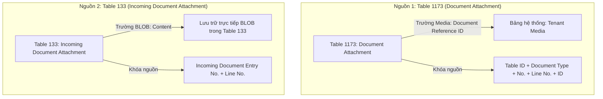
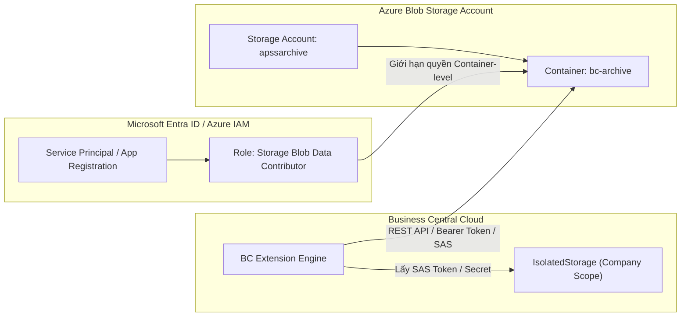
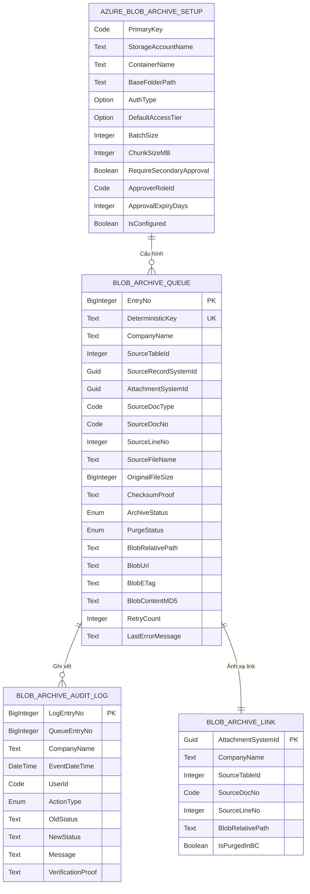
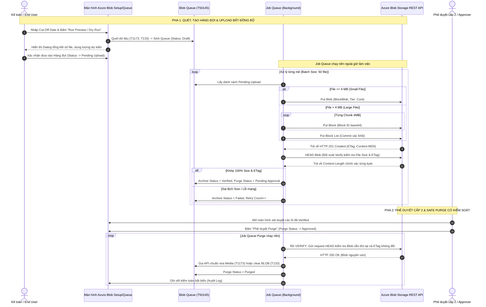

# TÀI LIỆU THIẾT KẾ KỸ THUẬT & MÔ HÌNH DỮ LIỆU

## Dự án: Business Central File Archiving to Azure Blob Storage

**Phiên bản:** 1.0 | **Trạng thái:** Thiết kế kiến trúc giải pháp lưu trữ phân tầng cấp 2 (Cold/Archive Tiering) - Khóa cứng tính năng Purge  
**Phạm vi:** Dynamics 365 Business Central Cloud SaaS (v28) & Microsoft Azure Blob Storage (ABS)

---

## MỤC LỤC

1. [Tổng quan dự án & Động lực kiến trúc Azure Blob Storage](#1-tổng-quan-dự-án--động-lực-kiến-trúc-azure-blob-storage)
2. [Nguyên tắc cốt lõi & Giới hạn đỏ (Safety Guardrails)](#2-nguyên-tắc-cốt-lõi--giới-hạn-đỏ-safety-guardrails)
3. [Khảo sát dữ liệu nguồn & Xác minh Schema BC v28](#3-khảo-sát-dữ-liệu-nguồn--xác-minh-schema-bc-v28)
4. [Bằng chứng Thực nghiệm Purge Media & Khả năng Tích hợp BC](#4-bằng-chứng-thực-nghiệm-purge-media--khả-năng-tích-hợp-bc)
5. [Kiến trúc bảo mật, Xác thực & Phân quyền Azure Storage](#5-kiến-trúc-bảo-mật-xác-thực--phân-quyền-azure-storage)
6. [Quy chuẩn lưu trữ, Cấu trúc Blob Container & Chính sách Phân tầng](#6-quy-chuẩn-lưu-trữ-cấu-trúc-blob-container--chính-sách-phân-tầng)
7. [Chi tiết Mô hình Dữ liệu (Data Model AL Extension cho Azure Blob)](#7-chi-tiết-mô-hình-dữ-liệu-data-model-al-extension-cho-azure-blob)
8. [Thiết kế Giao diện Người dùng trong BC (UI Integration & Access Link)](#8-thiết-kế-giao-diện-người-dùng-trong-bc-ui-integration--access-link)
9. [Đặc tả Quy trình Bất đồng bộ 2 Pha (Async Pipeline Specification)](#9-đặc-tả-quy-trình-bất-đồng-bộ-2-pha-async-pipeline-specification)
10. [Cơ chế Chống lỗi, Throttling & Khử trùng lặp (Resilience & Idempotency)](#10-cơ-chế-chống-lỗi-throttling--khử-trùng-lặp-resilience--idempotency)
11. [Kế hoạch Kiểm thử Mở rộng (23 Test Cases bao gồm Rủi ro Production)](#11-kế-hoạch-kiểm-thử-mở-rộng-23-test-cases-bao-gồm-rủi-ro-production)
12. [Kết luận & Chốt chặn Triển khai (Purge Hard-Lock Gatekeeper)](#12-kết-luận--chốt-chặn-triển-khai-purge-hard-lock-gatekeeper)

---

## 1. TỔNG QUAN DỰ ÁN & ĐỘNG LỰC KIẾN TRÚC AZURE BLOB STORAGE

### 1.1. Bối cảnh Dung lượng & Động lực Mở rộng sang Azure Blob

Trong kiến trúc tổng thể của giải pháp lưu trữ, việc di chuyển tệp đính kèm từ Business Central sang SharePoint Online (Phase 1) đã giải quyết được bài toán giải phóng bộ nhớ cơ sở dữ liệu và cho phép nhân viên kế toán mở xem tệp trực tiếp trên trình duyệt. Tuy nhiên, khi hệ thống vận hành quy mô lớn qua nhiều năm, SharePoint Online bộc lộ các giới hạn:

1. **Hạn mức dung lượng SharePoint (Tenant Quota):**
   - Mặc định mỗi tenant Microsoft 365 chỉ có `1 TB + (10 GB x số user)`. Với hàng trăm nghìn chứng từ phát sinh hàng năm, SharePoint sẽ chạm ngưỡng cảnh báo dung lượng trong vòng 1-2 năm.
2. **Chi phí mua thêm dung lượng SharePoint:**
   - Đơn giá dung lượng bổ sung của SharePoint Online là xấp xỉ **\$0.20 / GB / tháng** (tương đương \$200 / TB / tháng). Đây là mức chi phí rất cao đối với các hồ sơ lưu trữ tĩnh (chỉ phục vụ thanh tra, kiểm toán thuế và rất hiếm khi được truy xuất).
3. **Ưu thế vượt trội của Azure Blob Storage (ABS):**
   - **Chi phí cực thấp:** 
     - *Hot Tier:* ~\$0.018 / GB / tháng.
     - *Cool Tier:* ~\$0.010 / GB / tháng (tiết kiệm 95% so với SharePoint).
     - *Archive Tier / Cold Tier:* ~\$0.00099 / GB / tháng (tiết kiệm đến **99.5%** so với SharePoint, chỉ tốn ~\$1 / TB / tháng).
   - **Khả năng mở rộng (Scalability):** Dung lượng không giới hạn vật lý (hỗ trợ hàng Petabyte).
   - **Tích hợp sẵn có:** Business Central v28 được tích hợp sẵn module **`Azure Blob Storage Services API`** (nằm trong Microsoft System Application), hỗ trợ kết nối trực tiếp, ổn định và bảo mật cao mà không phụ thuộc vào thư viện thứ ba.

### 1.2. Chiến lược Lưu trữ Phân tầng (Tiered Storage Strategy)

Mô hình kiến trúc hướng tới việc phân bổ lưu trữ thông minh:

$$\text{BC Media} \xrightarrow{\text{Scan & Ingest}} \begin{cases} \mathbf{\text{SharePoint Online}} & (\le 1\text{--}2\text{ năm: Hot, truy cập thường xuyên}) \\ \mathbf{\text{Azure Blob Storage}} & (> 2\text{ năm hoặc khi SharePoint đạt 85\% Quota: Cold/Archive})} \end{cases}$$

Tài liệu này đặc tả độc lập toàn bộ thiết kế kỹ thuật của phương án **Archiving trực tiếp từ Business Central sang Azure Blob Storage** (hoặc làm tầng lưu trữ thứ cấp khi SharePoint đầy).

---

## 2. NGUYÊN TẮC CỐT LÕI & GIỚI HẠN ĐỎ (SAFETY GUARDRAILS)

> [!CAUTION]
> **CÁC NGUYÊN TẮC BẮT BUỘC TUÂN THỦ:**
>
> 1. **TUYỆT ĐỐI KHÔNG thao tác hoặc xóa trực tiếp trên bảng `Tenant Media` hay sử dụng Direct SQL.** Mọi thao tác phải thông qua API và Record chuẩn của BC để BC tự quản lý reference count.
> 2. **TUYỆT ĐỐI KHÔNG can thiệp vào các bảng nghiệp vụ và chứng từ lưu trữ:**
>    - `Sales Header Archive` / `Sales Line Archive` (Table 5107, 5108)
>    - `Purchase Header Archive` / `Purchase Line Archive` (Table 5109, 5110)
>    - APSS SQ-to-PQ archive records
>    - Toàn bộ sổ cái giao dịch/kế toán (`G/L Entry`, `Cust. Ledger Entry`, v.v.)
>    - System Media và Application Media
> 3. **Không chỉnh sửa trực tiếp mã nguồn Production của APSS.** Đóng gói giải pháp trong **AL Extension độc lập**.
> 4. **Tách rời tuyệt đối 2 pha: Upload vs. Purge.** Không bao giờ xóa file trên BC ngay sau khi upload nếu chưa qua quy trình phê duyệt (Secondary Approval Workflow).
> 5. **Loại bỏ tính năng Restore ra khỏi Phase 1 (MVP):** Không đưa "Restore Attachment to BC" vào giai đoạn đầu vì rủi ro tạo duplicate Media và ghi sai source record rất cao. Phase 1 chỉ tập trung vào: Preview $\rightarrow$ Queue $\rightarrow$ Upload $\rightarrow$ Verify $\rightarrow$ Retain Link $\rightarrow$ Approval $\rightarrow$ Purge $\rightarrow$ Audit.
> 6. **KHÓA CỨNG TÍNH NĂNG PURGE (HARD-LOCK PURGE GATEKEEPER):** Trong giai đoạn hiện tại, extension CHỈ CHO PHÉP thực thi: **Preview / Dry Run**, **Upload to Azure Blob** và **Đối soát Verify (Size & MD5/SHA-256)**. Toàn bộ hành vi xóa nhị phân (Purge) bị khóa cứng cả ở tầng giao diện lẫn tầng nghiệp vụ (codeunit), tuyệt đối không xóa bất kỳ dữ liệu nào trên Production cho đến khi vượt qua đủ 5 điều kiện tiên quyết.
> 7. **XÁC MINH DẢI OBJECT ID (50140..50189):** Extension sử dụng dải ID độc lập an toàn đã được xác minh sạch trên tenant APSS.

---

## 3. KHẢO SÁT DỮ LIỆU NGUỒN & XÁC MINH SCHEMA BC V28

Tránh mọi suy đoán lý thuyết, cấu trúc dữ liệu nguồn được kế thừa 100% từ kết quả khảo sát thực tế trên môi trường BC v28:



### 3.1. Xác minh Table 1173 (`Document Attachment`)
- **Khóa chính thực tế (PK):** `Table ID`, `Number`, `Document Type`, `Line No.`, `ID`.
- **Trường định danh bất biến:** `SystemId` (GUID) — Ổn định và duy nhất cho từng bản ghi attachment, dùng làm thành phần cấu tạo khóa Idempotency.
- **Trường chứa tệp nhị phân:** `Document Reference ID` (kiểu `Media`).
- **Rủi ro Shared Media:** Một GUID trong `Tenant Media` có thể được nhiều bản ghi `Document Attachment` tham chiếu tới.
- **Phương thức Purge chuẩn:** `Clear(DocumentAttachment."Document Reference ID")` kết hợp `DocumentAttachment.Modify(false)`.

### 3.2. Xác minh Table 133 (`Incoming Document Attachment`)
- **Khóa chính thực tế (PK):** `Incoming Document Entry No.`, `Line No.`.
- **Trường định danh bất biến:** `SystemId` (GUID).
- **Trường chứa tệp nhị phân:** `Content` (kiểu `BLOB`).
- **Phương thức Purge chuẩn:** `Clear(IncomingDocAttachment.Content)` kết hợp `IncomingDocAttachment.Modify(false)`.

### 3.3. Chiến lược Cut-Off Date
Hỗ trợ cấu hình linh hoạt:
- **`Posting Date`** (Ngày ghi sổ): Khuyến nghị cho Kế toán / Tài chính.
- **`Document Date`** (Ngày chứng từ): Phù hợp cho hồ sơ thương mại.
- **`Attached Date`** (Ngày đính kèm): Fallback kỹ thuật.

### 3.4. Nguyên tắc Ngữ cảnh Đa Pháp nhân (`DataPerCompany = true`)
- Dữ liệu chứng từ phân vùng độc lập giữa các công ty (ví dụ `APSS-SG` và `APSS-VN`).
- Code AL bắt buộc gọi `DocAttachment.ChangeCompany(ArchiveQueueEntry."Company Name")` trước khi truy vấn hoặc đọc stream nhị phân.

---

## 4. BẰNG CHỨNG THỰC NGHIỆM PURGE MEDIA & KHẢ NĂNG TÍCH HỢP BC

1. **Khóa an toàn Metadata:** Đã kiểm chứng thực nghiệm trên Sandbox: khi `Clear(Document Reference ID)` và gọi `Modify(false)`, BC xóa liên kết trỏ tới Media nhưng giữ nguyên 100% dòng metadata (`ID`, `File Name`, `File Extension`, `Attached Date`).
2. **Khả năng tương thích ABS Native Client:** Microsoft cung cấp module chuẩn **`Azure Blob Storage Services API`** (thuộc System Application), bao gồm:
   - Codeunit `ABS Container Client`
   - Codeunit `ABS Blob Client`
   - Codeunit `Storage Service Authorization` (hỗ trợ Shared Key, SAS Token, và Microsoft Entra ID OAuth2).
   - Module này tối ưu hóa luồng dữ liệu Stream trực tiếp từ InStream sang Http Content mà không gây tràn RAM trên Cloud Sandbox.

---

## 5. KIẾN TRÚC BẢO MẬT, XÁC THỰC & PHÂN QUYỀN AZURE STORAGE



### 5.1. Mô hình Xác thực Hỗ trợ (Authentication Architecture)

Hệ thống thiết kế hỗ trợ 2 phương thức xác thực chuẩn doanh nghiệp:

1. **Phương thức 1: Shared Access Signatures (SAS Token) [Khuyến nghị cho Phase 1]:**
   - Tạo **Account SAS** hoặc **Service SAS** cấp quyền chỉ trên đúng Blob Container chỉ định (`bc-archive`).
   - Quyền hạn (Permissions): `Create (c)`, `Write (w)`, `Read (r)`, `List (l)`. **Tuyệt đối KHÔNG cấp quyền Delete (d)** cho con Bot BC.
   - SAS Token được mã hóa và lưu an toàn vào `IsolatedStorage` của Business Central (`DataScope::Company`).
2. **Phương thức 2: Microsoft Entra ID (Service Principal & OAuth2):**
   - Tương tự như kiến trúc SharePoint, BC xác thực Client Credentials Grant với Entra ID để nhận Bearer Token cho resource `https://storage.azure.com/`.
   - App Registration được gán quyền RBAC: **`Storage Blob Data Contributor`** nhưng **chỉ gán ở phạm vi Container lưu trữ (Container-level Scope)**, không gán ở mức Subscription hay Resource Group.

### 5.2. Cơ chế Bảo vệ Đường link Truy cập (SAS URL Generation for End-Users)
- Blob Container được cấu hình ở chế độ **Private (No anonymous access)**.
- Khi người dùng bấm action **`Open from Azure Blob`** trên chứng từ BC, hệ thống không mở trực tiếp một link công khai, mà tự động sinh một **Read-only SAS URL tạm thời có thời hạn ngắn (Short-Lived SAS Token, ví dụ 15 - 30 phút)** thông qua hàm sinh SAS bảo mật. Sau thời gian này, link tự động hết hiệu lực, chống rò rỉ dữ liệu ra bên ngoài.

---

## 6. QUY CHUẨN LƯU TRỮ, CẤU TRÚC BLOB CONTAINER & CHÍNH SÁCH PHÂN TẦNG

### 6.1. Cấu trúc Đường dẫn Blob (Virtual Directory Hierarchy)

Azure Blob Storage quản lý tệp theo mô hình phẳng (Flat namespace) với tiền tố ảo (Virtual Path Prefixes) phân tách bởi ký tự `/`:

$$\mathbf{\text{[Blob Container Name]}} \;/\; \mathbf{\text{[Base Folder Path]}} \;/\; \mathbf{\text{[Company Name]}} \;/\; \mathbf{\text{[Document Type]}} \;/\; \mathbf{\text{[Document No.]}} \;/\; \mathbf{\text{[File Name]}}$$

*Ví dụ:* `bc-archive/apss-sg/PURCHASE_INVOICE/PINV-2023-0899/receipt-tax.pdf`

### 6.2. Quy tắc Làm sạch Đường dẫn (Sanitization)
- Tên Container tuân thủ quy tắc Azure: chỉ chứa chữ thường, số, dấu gạch ngang `-`, độ dài 3-63 ký tự.
- Tên Blob ảo (Virtual Path):
  - Ký tự cấm và ký tự điều khiển được chuyển thành `_`.
  - Loại bỏ chuỗi `../` hoặc `..\` để triệt tiêu lỗ hổng Path Traversal.
  - Tổng độ dài đường dẫn Blob $\le 1024$ ký tự (Azure hỗ trợ lên tới 1024 ký tự).

### 6.3. Chính sách Phân tầng Lưu trữ & Vòng đời (Blob Lifecycle Management)
- **Tầng truy cập ban đầu (Default Ingest Tier):** Tệp được upload mặc định vào **`Cool Tier`** để tối ưu hóa chi phí lưu trữ ngay từ ngày đầu tiên.
- **Azure Blob Lifecycle Management Rules (Tự động hóa trên Azure):**
  - Cấu hình rule trên Storage Account: Nếu Blob có thời gian tạo $> 730$ ngày (2 năm), Azure tự động chuyển tier từ **`Cool`** sang **`Archive Tier`** (chi phí giảm xuống \$0.00099/GB/tháng).
- **Tính năng Immutability / WORM (Write Once, Read Many):**
  - Cấu hình **Time-based Retention Policy** trên Container để khóa không cho phép sửa/xóa tệp trong vòng 10 năm theo đúng quy định kiểm toán kế toán tài chính.

---

## 7. CHI TIẾT MÔ HÌNH DỮ LIỆU (DATA MODEL AL EXTENSION CHO AZURE BLOB)

Mô hình dữ liệu được thiết kế tương thích hoàn hảo và độc lập trên dải ID `50140 .. 50189`:



### 7.1. Bảng 1: `Azure Blob Archive Setup` (Table 50144)

```al
namespace APSS.FileArchiving;

table 50144 "Azure Blob Archive Setup"
{
    DataClassification = CustomerContent;
    Caption = 'Azure Blob Archive Setup';

    fields
    {
        field(1; "Primary Key"; Code[10])
        {
            Caption = 'Primary Key';
        }
        field(10; "Storage Account Name"; Text[100])
        {
            Caption = 'Storage Account Name';
        }
        field(11; "Container Name"; Text[100])
        {
            Caption = 'Container Name';
        }
        field(12; "Base Folder Path"; Text[250])
        {
            Caption = 'Base Folder Path';
        }
        field(13; "Authentication Type"; Option)
        {
            Caption = 'Authentication Type';
            OptionMembers = "SAS Token","Entra ID Client Credentials","Shared Key";
            OptionCaption = 'SAS Token,Entra ID Client Credentials,Shared Key';
        }
        field(14; "Default Access Tier"; Option)
        {
            Caption = 'Default Access Tier';
            OptionMembers = "Hot","Cool","Cold","Archive";
            OptionCaption = 'Hot,Cool,Cold,Archive';
            InitValue = "Cool";
        }
        field(20; "Cut-Off Date Rule"; Option)
        {
            Caption = 'Cut-Off Date Evaluation Rule';
            OptionMembers = "Posting Date","Document Date","Attached Date";
            OptionCaption = 'Posting Date,Document Date,Attached Date';
        }
        field(21; "Batch Size"; Integer)
        {
            Caption = 'Batch Size (per Job Run)';
            InitValue = 50;
            MinValue = 1;
            MaxValue = 500;
        }
        field(22; "Chunk Size (MB)"; Integer)
        {
            Caption = 'Chunk Size for Block Upload (MB)';
            InitValue = 4;
            MinValue = 1;
            MaxValue = 100;
        }
        field(30; "Require Secondary Approval"; Boolean)
        {
            Caption = 'Require Secondary Approval for Purge';
            InitValue = true;
        }
        field(31; "Approver Role ID"; Code[20])
        {
            Caption = 'Approver Permission Role ID';
            TableRelation = "Aggregate Permission Set"."Role ID";
        }
        field(32; "Approval Expiry (Days)"; Integer)
        {
            Caption = 'Approval Expiry (Days)';
            InitValue = 7;
        }
        field(40; "Is Configured"; Boolean)
        {
            Caption = 'Is Configured';
        }
    }

    keys
    {
        key(PK; "Primary Key")
        {
            Clustered = true;
        }
    }
}
```

### 7.2. Bảng 2: `Blob Archive Queue Entry` (Table 50145)

```al
namespace APSS.FileArchiving;

table 50145 "Blob Archive Queue Entry"
{
    DataClassification = CustomerContent;
    Caption = 'Blob Archive Queue Entry';

    fields
    {
        field(1; "Entry No."; BigInteger)
        {
            AutoIncrement = true;
            Caption = 'Entry No.';
        }
        field(2; "Deterministic Archive Key"; Text[128])
        {
            Caption = 'Deterministic Archive Key (SHA-256)';
        }
        field(3; "Company Name"; Text[30])
        {
            Caption = 'Company Name';
            TableRelation = Company.Name;
        }
        field(4; "Source Table ID"; Integer)
        {
            Caption = 'Source Table ID';
        }
        field(5; "Source Record SystemId"; Guid)
        {
            Caption = 'Source Document Record SystemId';
        }
        field(6; "Attachment SystemId"; Guid)
        {
            Caption = 'Attachment SystemId';
        }
        field(7; "Source Document Type"; Code[30])
        {
            Caption = 'Document Type';
        }
        field(8; "Source Document No."; Code[50])
        {
            Caption = 'Document No.';
        }
        field(9; "Source Line No."; Integer)
        {
            Caption = 'Line No.';
        }
        field(10; "Source Attachment ID"; Integer)
        {
            Caption = 'Attachment ID / Entry No.';
        }
        field(20; "File Name"; Text[250])
        {
            Caption = 'Original File Name';
        }
        field(21; "File Extension"; Text[30])
        {
            Caption = 'File Extension';
        }
        field(22; "Original File Size (Bytes)"; BigInteger)
        {
            Caption = 'Original File Size (Bytes)';
        }
        field(23; "File Hash / Checksum"; Text[64])
        {
            Caption = 'Calculated Checksum (SHA-256)';
        }
        field(30; "Archive Status"; Enum "Archive Process Status")
        {
            Caption = 'Archive Status';
        }
        field(31; "Purge Status"; Enum "Purge Process Status")
        {
            Caption = 'Purge Status';
        }
        field(40; "Blob Relative Path"; Text[500])
        {
            Caption = 'Blob Relative Path';
        }
        field(41; "Blob Full URL"; Text[1000])
        {
            Caption = 'Blob Permanent URL';
            ExtendedDatatype = URL;
        }
        field(42; "Blob ETag"; Text[150])
        {
            Caption = 'Blob ETag / Version';
        }
        field(43; "Blob Content MD5"; Text[64])
        {
            Caption = 'Blob Content MD5 Hash';
        }
        field(50; "Retry Count"; Integer)
        {
            Caption = 'Retry Count';
            InitValue = 0;
        }
        field(51; "Max Retries"; Integer)
        {
            Caption = 'Max Retries';
            InitValue = 5;
        }
        field(52; "Last Error Message"; Text[1000])
        {
            Caption = 'Last Error Message';
        }
        field(60; "Queued DateTime"; DateTime)
        {
            Caption = 'Queued DateTime';
        }
        field(61; "Uploaded DateTime"; DateTime)
        {
            Caption = 'Uploaded DateTime';
        }
        field(62; "Verified DateTime"; DateTime)
        {
            Caption = 'Verified DateTime';
        }
        field(63; "Approved DateTime"; DateTime)
        {
            Caption = 'Approved DateTime';
        }
        field(64; "Approved By User"; Code[50])
        {
            Caption = 'Approved By User';
        }
        field(65; "Purged DateTime"; DateTime)
        {
            Caption = 'Purged DateTime';
        }
        field(70; "Source Record Exists"; Boolean)
        {
            Caption = 'Source Document Exists';
            InitValue = true;
        }
        field(71; "Is Shared Media"; Boolean)
        {
            Caption = 'Is Shared Media Reference';
        }
        field(72; "Is Dry Run"; Boolean)
        {
            Caption = 'Is Dry Run Record';
        }
    }

    keys
    {
        key(PK; "Entry No.")
        {
            Clustered = true;
        }
        key(Idx_Key; "Deterministic Archive Key")
        {
            Unique = true;
        }
        key(Idx_Status; "Archive Status", "Purge Status")
        {
        }
        key(Idx_CompanyDoc; "Company Name", "Source Table ID", "Source Document No.")
        {
        }
    }
}
```

### 7.3. Bảng 3: `Blob Archive Audit Log` (Table 50146)

```al
namespace APSS.FileArchiving;

table 50146 "Blob Archive Audit Log"
{
    DataClassification = CustomerContent;
    Caption = 'Blob Archive Audit Log';

    fields
    {
        field(1; "Log Entry No."; BigInteger)
        {
            AutoIncrement = true;
            Caption = 'Log Entry No.';
        }
        field(2; "Queue Entry No."; BigInteger)
        {
            Caption = 'Queue Entry No.';
            TableRelation = "Blob Archive Queue Entry"."Entry No.";
        }
        field(3; "Company Name"; Text[30])
        {
            Caption = 'Company Name';
        }
        field(4; "Event DateTime"; DateTime)
        {
            Caption = 'Event Date Time';
        }
        field(5; "User ID"; Code[50])
        {
            Caption = 'User ID';
            DataClassification = EndUserIdentifiableInformation;
        }
        field(6; "Action Type"; Enum "Archive Audit Action")
        {
            Caption = 'Action Type';
        }
        field(7; "Old Status"; Text[50])
        {
            Caption = 'Old Status';
        }
        field(8; "New Status"; Text[50])
        {
            Caption = 'New Status';
        }
        field(10; "Message"; Text[1000])
        {
            Caption = 'Log Message';
        }
        field(11; "Verification Proof"; Text[500])
        {
            Caption = 'Verification Proof (Size/ETag/MD5)';
        }
    }

    keys
    {
        key(PK; "Log Entry No.")
        {
            Clustered = true;
        }
        key(Idx_Queue; "Queue Entry No.")
        {
        }
    }
}
```

### 7.4. Bảng 4: `Blob Archive Link Mapping` (Table 50147)

```al
namespace APSS.FileArchiving;

table 50147 "Blob Archive Link Mapping"
{
    DataClassification = CustomerContent;
    Caption = 'Blob Archive Link Mapping';

    fields
    {
        field(1; "Attachment SystemId"; Guid)
        {
            Caption = 'Attachment SystemId';
        }
        field(2; "Company Name"; Text[30])
        {
            Caption = 'Company Name';
            TableRelation = Company.Name;
        }
        field(3; "Source Table ID"; Integer)
        {
            Caption = 'Source Table ID';
        }
        field(4; "Source Document No."; Code[50])
        {
            Caption = 'Document No.';
        }
        field(5; "Source Line No."; Integer)
        {
            Caption = 'Line No.';
        }
        field(6; "File Name"; Text[250])
        {
            Caption = 'File Name';
        }
        field(10; "Blob Relative Path"; Text[500])
        {
            Caption = 'Blob Relative Path';
        }
        field(11; "Is Purged In BC"; Boolean)
        {
            Caption = 'Is Binary Purged In BC';
        }
        field(12; "Archived DateTime"; DateTime)
        {
            Caption = 'Archived Date Time';
        }
    }

    keys
    {
        key(PK; "Company Name", "Attachment SystemId")
        {
            Clustered = true;
        }
        key(Idx_Doc; "Company Name", "Source Table ID", "Source Document No.", "Source Line No.")
        {
        }
    }
}
```

---

## 8. THIẾT KẾ GIAO DIỆN NGƯỜI DÙNG TRONG BC (UI INTEGRATION & ACCESS LINK)

### 8.1. Mở rộng Trang chuẩn `Document Attachment Details` (Page 1173)
- Bổ sung cột: **`Archived to Azure Blob`** (Boolean).
- Bổ sung Action: **`Open from Azure Blob`**.
  - Khi người dùng click, codeunit client sẽ tự động gọi API sinh **Read-only SAS URL tạm thời (thời hạn 15 phút)** và mở file qua `Hyperlink(TemporarySasUrl)`.
  - Nếu file đã bị purge nhị phân trong BC, khi bấm nút preview chuẩn, hệ thống tự động thông báo và chuyển hướng mở qua SAS URL an toàn.

### 8.2. Mở rộng `Incoming Documents` (Page 193 / Page 194)
- Bổ sung Factbox hiển thị đường dẫn mở file từ Azure Blob Storage.
- Hỗ trợ đầy đủ trường hợp chứng từ có nhiều file đính kèm (`Multiple Attachments`).

---

## 9. ĐẶC TẢ QUY TRÌNH BẤT ĐỒNG BỘ 2 PHA (ASYNC PIPELINE SPECIFICATION)



---

## 10. CƠ CHẾ CHỐNG LỖI, THROTTLING & KHỬ TRÙNG LẶP (RESILIENCE & IDEMPOTENCY)

### 10.1. Khóa Định danh Khử Trùng lặp (Deterministic Archive Key)
Mỗi bản ghi hàng đợi được cấp một **`Deterministic Archive Key`**:

$$\text{Key} = \text{SHA256}(\text{Company Name} + \text{Source Table ID} + \text{Attachment SystemId} + \text{Original File Size})$$

- **Nguyên tắc Re-run (HEAD-first Check):** Trước khi upload bất kỳ Blob nào, BC luôn gửi request **`HEAD Blob`** tới đường dẫn chỉ định:
  - Nếu Blob đã tồn tại và có kích thước `Content-Length` khớp chính xác 100%: Hệ thống thu hồi ETag, chuyển thẳng sang trạng thái `Verified` mà không upload đè. Chặn triệt để nguy cơ ghi đè dữ liệu hoặc tạo rác.

### 10.2. Hợp đồng Đối soát (Verification Contract)
- **Kích thước file (File Size):** Bắt buộc đối chiếu khớp chính xác đến từng byte (`Original File Size == Blob Content-Length`).
- **Tính toàn vẹn (Content-MD5 & SHA-256):** 
  - Khi gửi lệnh `Put Blob` hoặc `Put Block`, BC tự động tính mã MD5 và gửi trong header `Content-MD5`. Azure Storage tự động kiểm tra mã băm này; nếu dữ liệu bị lỗi đường truyền (corrupted bits), Azure sẽ lập tức trả về `HTTP 400 Bad Request` (InvalidMd5) và hủy thao tác.
  - Sau khi upload, kết hợp đối soát SHA-256 nội bộ với `ETag` phiên bản của Blob.

### 10.3. Xử lý Giới hạn Băng thông & Throttling (HTTP 503 Server Busy / 429)
- Azure Storage có thể trả về `HTTP 503 (Server Busy)` khi chạm ngưỡng IOPS hoặc băng thông của Storage Account.
- Bắt mã lỗi, đọc header `Retry-After` (nếu có), áp dụng thuật toán **Exponential Backoff**: Tạm dừng mẻ xử lý $10\text{s}, 20\text{s}, 40\text{s}$ trước khi thử lại, bảo vệ Job Queue không bị crash.

### 10.4. Kiểm soát Phê duyệt Purge Chống Chạy Nhầm
- **Phân quyền vai trò:** Chỉ người dùng có Role ID chỉ định mới có quyền bấm phê duyệt.
- **Thời hạn phê duyệt:** Lô duyệt quá hạn (mặc định 7 ngày) tự động chuyển sang `Expired`.
- **Chặn Purge nếu Blob bị thay đổi:** Trước khi purge, nếu bước Re-verify phát hiện Blob trên Azure đã bị xóa hoặc ETag thay đổi, hệ thống lập tức hủy lệnh purge và phát cảnh báo lỗi.

---

## 11. KẾ HOẠCH KIỂM THỬ MỞ RỘNG (23 TEST CASES BAO GỒM RỦI RO PRODUCTION)

Mọi kịch bản phải được kiểm thử đạt 100% trên môi trường **Sandbox tạo từ bản sao của Production**:

| Nhóm kiểm thử | Mã TC | Kịch bản kiểm thử | Kết quả kỳ vọng (Pass Criteria) |
| :--- | :---: | :--- | :--- |
| **Cơ bản** | **TC-01** | Chế độ Preview / Dry-Run | Hiển thị danh sách, số lượng, dung lượng dự kiến. **Không upload, không xóa bất kỳ dữ liệu nào.** |
| | **TC-02** | Upload file nhỏ thông thường ($\le 4\text{ MB}$) | Upload thành công vào đúng Container và Virtual Path `Company/Type/No/`. Verify size khớp từng byte. |
| | **TC-03** | Resumable Chunked Block Upload ($> 4\text{ MB}$) | File 45 MB upload trơn tru qua từng Block 4 MB và `Put Block List` thành công. |
| | **TC-04** | Sanitize ký tự cấm và URL Container | Ký tự đặc biệt được làm sạch, Container Name đúng chuẩn Azure. |
| | **TC-05** | Mở link từ giao diện BC | Người dùng click `Open from Azure Blob` trên Page 1173 tự động sinh Short-lived SAS Token mở file thành công trên browser. |
| **Toàn vẹn Dữ liệu** | **TC-06** | **Shared Media giữa nhiều chứng từ** | File đính kèm ở Order và Invoice dùng chung 1 Media GUID. Purge ở Invoice **không làm hỏng** file ở Order. |
| | **TC-07** | **2 Company trùng Document No.** | Cả 2 công ty đều có hóa đơn `INV-001`. File được tách biệt hoàn toàn theo 2 virtual folder Company trên Azure Blob. |
| | **TC-08** | **2 file cùng tên khác nội dung trong 1 chứng từ** | File thứ 2 tự động thêm hậu tố `_[LineNo]`, cả 2 file đều lưu trữ độc lập. |
| | **TC-09** | **Attachment không có source document (Orphan)** | Hệ thống phát hiện `Source Record Exists = False`, đánh dấu `Skipped / Orphan`, không upload sai lệch. |
| | **TC-10** | **Source document bị xóa/archive trong lúc scan** | Bắt ngoại lệ an toàn, ghi log cảnh báo, không làm crash Job Queue. |
| | **TC-11** | **Attachment bị thay đổi nội dung trong lúc scan** | Checksum thay đổi $\rightarrow$ Hệ thống hủy mẻ xử lý của file đó, yêu cầu scan lại. |
| **Sự cố Mạng & Storage** | **TC-12** | **Upload thành công nhưng BC rollback transaction** | Lần chạy kế tiếp gửi request HEAD trước, nhận diện Blob đã có, không tạo bản sao rác. |
| | **TC-13** | **BC gửi lệnh nhưng Azure Blob timeout** | Đánh dấu lỗi, tăng `Retry Count`, tự động retry ở lượt Job Queue sau. |
| | **TC-14** | **SAS Token hết hạn giữa phiên upload block** | Cảnh báo lỗi xác thực, yêu cầu cập nhật SAS Token hợp lệ, không gây hỏng dữ liệu. |
| | **TC-15** | **Azure Storage trả về lỗi 503 Server Busy liên tục** | Bắt mã lỗi, kích hoạt Exponential Backoff, lùi tiến trình an toàn. |
| | **TC-16** | **Tệp vượt giới hạn kích thước cho phép** | Cảnh báo lỗi dung lượng vượt ngưỡng cấu hình, ghi log kiểm toán, bỏ qua file an toàn. |
| **Bảo mật & Phê duyệt** | **TC-17** | **Người dùng truy cập trực tiếp URL Blob mà không có SAS** | Azure Blob chặn quyền truy cập ẩn danh (HTTP 403 / 404 ResourceNotFound) theo đúng chuẩn Container Private. |
| | **TC-18** | **Cố tình purge khi chưa có Approved** | Lệnh purge bị chặn đứng ở mức tầng nghiệp vụ. |
| | **TC-19** | **Phê duyệt quá hạn (Approval Expiry)** | Lô duyệt quá 7 ngày bị chuyển sang `Expired`, bắt buộc re-verify trước khi duyệt lại. |
| | **TC-20** | **Blob trên Azure bị xóa trước khi purge** | Bước Re-verify phát hiện Blob mất tích $\rightarrow$ Hủy lệnh purge, bảo vệ file gốc trong BC. |
| | **TC-21** | **Purge bị kích hoạt đồng thời (Race Condition)** | Cơ chế khóa bản ghi ngăn chặn việc 2 session cùng gọi lệnh purge trên 1 queue entry. |
| **Hệ thống & Vận hành** | **TC-22** | **Job Queue bị restart đột ngột giữa chừng** | Khởi động lại Job Queue: Các queue entry đang dở dang tự động resume từ điểm ngắt. |
| | **TC-23** | **Đo lường dung lượng sau khi purge** | Xác minh dung lượng Tenant Media và Incoming Document giảm thực tế trên Admin Center. |

---

## 12. KẾT LUẬN & CHỐT CHẶN TRIỂN KHAI (PURGE HARD-LOCK GATEKEEPER)

### 12.1. Kết luận Thẩm định Kiến trúc
- Phương án **Azure Blob Storage** là giải pháp bổ trợ lý tưởng cho SharePoint Online:
  1. Giải quyết triệt để bài toán Quota và chi phí khi lưu trữ dài hạn (tiết kiệm đến 99.5% chi phí lưu trữ nhờ Cool & Archive Tier).
  2. Kế thừa nguyên vẹn mô hình dữ liệu (Data Model), nguyên tắc chống trùng lặp (Deterministic Archive Key) và quy trình bất đồng bộ 2 pha đã được kiểm nghiệm.
  3. Sử dụng module chuẩn của Microsoft (`Azure Blob Storage Services API`) trong System Application giúp mã nguồn gọn nhẹ, bảo mật và tương thích hoàn toàn trên Business Central Cloud SaaS.

### 12.2. Chốt chặn An toàn: Duy trì Khóa cứng Tính năng Purge (Hard-Lock Purge Gatekeeper)
> [!CAUTION]
> **PURGE TIẾP TỤC BỊ KHÓA CỨNG:** Tương tự như phương án SharePoint, tính năng Purge tuyệt đối KHÔNG được kích hoạt trên Production cho đến khi vượt qua đầy đủ 4 chốt chặn kiểm định:
>
> 1. **Đo lường Thực tế Giải phóng Dung lượng Vật lý:** Theo dõi sự sụt giảm dung lượng thực tế của bảng `Tenant Media` trên trang *Admin Center > Capacity* sau khi chạy thử nghiệm trên Sandbox.
> 2. **Chốt Quy tắc Nghiệp vụ Cut-Off Date:** Thống nhất bằng văn bản với bộ phận Kế toán / Nghiệp vụ về ngày chốt lưu trữ.
> 3. **Phê duyệt Bảo mật & Thiết lập Hạ tầng Azure:** Cấu hình Storage Account, Container Private, Lifecycle Management Policy và cấp phát SAS Token có phạm vi tối thiểu (Least Privilege).
> 4. **Kiểm thử Tải Đồng thời (Stress Test):** Thực hiện kiểm thử tải với các tệp lớn dung lượng $> 50\text{ MB}$ qua cơ chế Block Blob để đảm bảo tính ổn định tuyệt đối của đường truyền.
